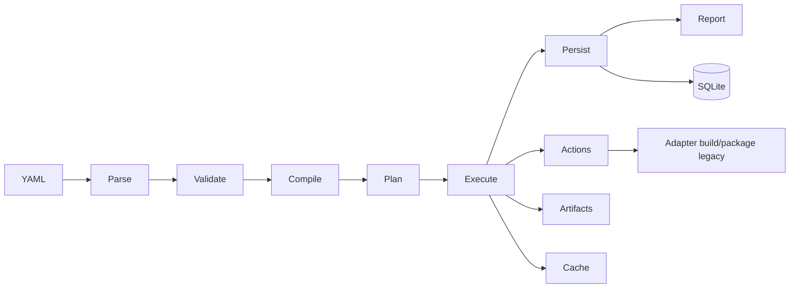

# Báo cáo triển khai ubuilder Pipeline

**Ngày báo cáo:** 23/11/2026  
**Dự án:** `C:/Users/gehihi/Documents/Projects/builder`  
**Phạm vi:** Nâng cấp `ubuilder` từ công cụ build desktop đa nền tảng thành workflow engine CI/CD cục bộ, khai báo bằng YAML qua `ubuilder pipeline`.  
**Trạng thái:** Hoàn thành phần triển khai, kiểm thử và tài liệu trên Windows x64. Legacy `build` / `package` / `release` vẫn hoạt động.

---

## 1. Tóm tắt điều hành

Đã bổ sung một tầng pipeline hoàn chỉnh gồm bảy giai đoạn: **Parse → Validate → Compile → Plan → Execute → Persist → Report**. Tầng này tái sử dụng các adapter build/package, executor, cache, artifacts và storage sẵn có, không tạo engine build thứ hai.

Các kết quả chính:

- 14 lệnh con `ubuilder pipeline` hoạt động, tất cả hỗ trợ `--json`.
- Workflow YAML có kiểm tra schema nghiêm ngặt, báo lỗi kèm dòng/cột.
- Matrix jobs, sóng phụ thuộc (`needs`), workspace cô lập, artifacts, cache, retry, timeout, hủy chéo tiến trình và phục hồi run bị treo.
- Lịch sử run/job/step lưu trong SQLite; có `status`, `logs`, `history`, `cancel`, `recover`.
- **121 bài kiểm thử đều đạt**; `cargo fmt` và `cargo clippy -D warnings` sạch.
- Tài liệu kiến trúc, DSL, IR, runtime, bảo mật, actions, ví dụ và trạng thái triển khai đã được viết.
- CI cho Windows và Ubuntu; ví dụ workflow chạy được đã được thêm.
- Mã nguồn đã được commit sạch trong Git.

---

## 2. Khảo sát hiện trạng

### 2.1 Môi trường phát triển

| Thành phần | Giá trị / trạng thái |
| --- | --- |
| Hệ điều hành | Windows 10.0.26300, x64 |
| Rust / Cargo | 1.99.1 stable |
| Target đã cài | `x86_64-pc-windows-msvc`, `x86_64-unknown-linux-gnu` |
| .NET SDK | 10.0.404 và 11.0.100 |
| Node.js | v26.13.1, kèm npm, npx, bun |
| Công cụ có sẵn | git, tar |
| Linker native | **Không có** `gcc`, `clang`, `lld-link`, `link.exe` trên `PATH` |
| Công cụ macOS | Không có `codesign`, `lipo`, `hdiutil`, `osxcross` |
| Công cụ đóng gói khác | Không có `makensis`, `zip`, `rpmbuild`, `dpkg-deb`, `appimagetool`, `wine`, `zig`, `cross` |

Hệ quả: build Rust trên Windows vẫn thành công vì `rustc` tự tìm được linker nội bộ, nhưng `pipeline plan` phát cảnh báo `linker-unverified` cho mọi job. Các target chéo và macOS chưa thể kiểm chứng end-to-end trên máy này.

### 2.2 Cấu trúc mã nguồn

Tại thời điểm báo cáo:

| Hạng mục | Số lượng |
| --- | --- |
| Tệp được Git theo dõi | 111 (gồm báo cáo này) |
| Tệp Rust | 82 |
| Dòng Rust | khoảng 24.000 |
| Tệp tài liệu Markdown | 11 |
| Bộ kiểm thử tích hợp | 5 |

Các module chính:

```text
src/cli              command parsing, JSON envelope
src/config           ubuilder.toml
src/detect           nhận diện framework
src/target           target chuẩn và triple
src/host             thông tin host
src/providers        facts và provisioning toolchain
src/planner          project → build plan
src/builder          điều phối build/package/release
src/adapters         Rust, .NET, Electron, Tauri
src/executor         chạy tiến trình, log, timeout, hủy
src/scheduler        scheduler legacy
src/cache            action cache
src/artifacts        đóng gói, manifest
src/validation       kiểm tra định dạng/kiến trúc artifact
src/signing          hook ký
src/storage          SQLite history và lease
src/security         containment, lọc env, redaction
src/telemetry        output người đọc và JSON
```

Tầng pipeline:

```text
src/pipeline/parser       đọc YAML, giới hạn 1 MiB
src/pipeline/schema       model serde, deny_unknown_fields
src/pipeline/validator    kiểm tra ngữ nghĩa, gom diagnostics
src/pipeline/compiler     schema → IR, topological sort, waves
src/pipeline/matrix       Cartesian expansion + include/exclude
src/pipeline/expression   lexer/parser/evaluator cho template và if
src/pipeline/planner      phân giải capability của host
src/pipeline/runtime      scheduler sóng, workspace, state machine
src/pipeline/history      status/logs/cancel/recover
src/pipeline/artifacts    content-addressed storage
src/pipeline/cache        cache workspace
src/pipeline/actions      11 built-in actions
src/pipeline/events       event tiến trình
src/pipeline/graph        Mermaid / DOT / JSON
src/cli/pipeline_cmd      CLI và JSON envelope
```

### 2.3 Hiện trạng kiểm thử ban đầu

Trước khi mở rộng pipeline, bộ kiểm thử gồm 74 bài: 65 unit test, 6 CLI, 1 real build, 2 compatibility. Các bài này là nền tảng để đảm bảo legacy không bị phá vỡ.

Trong quá trình khảo sát, các vấn đề sau được phát hiện:

| Vấn đề | Ảnh hưởng | Cách xử lý |
| --- | --- | --- |
| `matrix.include` thay thế toàn bộ combinations | Mất các tổ hợp không khớp, ví dụ mất `os: windows` | Merge tại chỗ vào tổ hợp tương thích; chỉ append khi không có tổ hợp nào khớp |
| Test parser kỳ vọng sai dòng lỗi | Test đỏ dù thông báo đúng | Sửa kỳ vọng về `workflow.yml:3` |
| `continue-on-error` đổi `status` thành `success` | Mất tín hiệu lỗi của step | Giữ `status: failure`, chỉ đặt `conclusion: success` |
| Không hỗ trợ `-` trong identifier biểu thức | Không đọc được `steps.cache.outputs.cache-hit` | Cho phép `-` trong identifier |
| Matrix `target: native` bị parse thành target lạ | Lỗi `UNSUPPORTED_TARGET` | Coi `native` / `auto` là target của host |
| Test runtime hard-code `windows-x64` | CI Ubuntu sẽ thất bại | Dùng `target: [native]` |
| Clippy còn 6 cảnh báo | CI `-D warnings` đỏ | Sửa closure, slice, `match`, thêm allow hợp lý |
| `.gitignore` có `**/target` và `dist` quá rộng | Commit đầu bỏ sót `src/target/mod.rs` và `fixtures/tauri-app/dist/index.html` | Thu hẹp pattern; commit bổ sung |

---

## 3. Công việc đã thực hiện

### 3.1 Sửa lỗi lõi

**Matrix include**

Cài đặt cũ gán `combinations = additions`, nên chỉ còn các tổ hợp khớp với include đầu tiên. Cài đặt mới duyệt từng tổ hợp, merge nếu không xung đột khóa, giữ nguyên tổ hợp không khớp và chỉ thêm tổ hợp mới khi include không khớp bất kỳ tổ hợp nào. Thứ tự vẫn deterministic theo `IndexMap`; giới hạn 256 job được giữ nguyên.

**Fail-fast**

Với matrix có `fail-fast: true` và không đặt `max-parallel`, semaphore nội bộ được đặt giới hạn 1 để thứ tự lỗi xác định; các sibling chưa chạy được đánh dấu `skipped`. Trạng thái job được ghi vào summary **trước khi** nhả permit, tránh race với scheduler.

**Timeout và song song**

Test timeout dùng `duration_ms` của report thay vì đồng hồ tiến trình, vì khởi động CLI mất khoảng 6 giây trên máy có antivirus. Executor hủy process tree sau khoảng 1 giây; test xác nhận step dưới 8 giây. Test song song xác nhận hai job 2 giây hoàn thành dưới 4 giây theo report.

**`continue-on-error`**

Trước đây runtime đặt `execution.status = "success"`, sau đó suy ra `conclusion` từ status nên mất thông tin thất bại. Nay step giữ `status: failure`, `conclusion: success`; job tiếp tục và không bị đánh dấu thất bại.

**Biểu thức có dấu gạch nối**

Lexer chỉ chấp nhận chữ, số và `_`. Các output như `cache-hit` bị hiểu là phép trừ và sinh lỗi `unexpected character '-'`. Lexer nay chấp nhận `-` trong identifier; đã có unit test và integration test cho luồng `needs` → `outputs` → `steps`.

**Target `native`**

Compiler gọi `Target::parse("native")` và trả `UNSUPPORTED_TARGET`. Nay compiler bỏ qua giá trị `native` / `auto` trước khi parse, fallback về target native của host. Plan và runtime đều dùng được.

**Workspace và artifact**

- `package::target` bỏ qua `native` / `auto`.
- `resolve_workspace_path` chỉ kiểm tra containment khi canonicalize thành công.
- Checkout loại trừ `.git`, `target`, `node_modules`, `.ubuilder`, `dist`, `dist-smoke`.
- Artifact lưu theo SHA-256, có manifest và kiểm tra tên an toàn.

### 3.2 Bổ sung kiểm thử

Đã thêm các bài kiểm thử hành vi thực tế:

| Bài kiểm thử | Nội dung xác minh |
| --- | --- |
| `retry_policy_reruns_a_failed_job` | Job thất bại lần đầu, tự chạy lại và thành công |
| `continue_on_error_keeps_the_job_running` | Step lỗi có `status=failure`, `conclusion=success`, job chạy tiếp |
| `job_outputs_flow_through_the_needs_context` | Output của job trước được job sau đọc qua `needs` |
| `recover_marks_an_interrupted_run_as_failed` | Kill tiến trình, `recover --stale-secs 0` chuyển run sang `failed` |
| `identifiers_allow_hyphenated_output_keys` | Biểu thức `steps.cache.outputs.cache-hit` hợp lệ |
| `cache_action_misses_then_hits_across_runs` | Lần đầu cache miss, lần sau cache hit |
| `matrix_fail_fast_skips_remaining_siblings` | Sibling chưa chạy bị `skipped` |
| `independent_jobs_run_in_parallel` | Hai job độc lập chạy song song |
| `two_jobs_transfer_artifacts_between_isolated_workspaces` | Upload ở job A, download ở job B với target `native` |
| `step_timeout_fails_the_job` | Timeout thực sự kill process tree |
| `cancel` / cross-process | Marker hủy được watcher 200 ms phát hiện |

Ngoài ra, các helper test được làm cross-platform bằng `sleep_command`, `matrix_fail_fast_command`, `cache_fill_command`; test artifact dùng `native` thay vì target Windows cố định.

### 3.3 Tài liệu

Đã viết hoặc cập nhật:

| Tệp | Nội dung |
| --- | --- |
| `README.md` | Tổng quan, quick start, bảng lệnh, envelope JSON, exit code |
| `docs/ARCHITECTURE.md` | Kiến trúc legacy + pipeline, quy tắc phân tầng |
| `docs/PIPELINE_ARCHITECTURE.md` | Bảy giai đoạn, module, data flow, storage layout |
| `docs/PIPELINE_DSL.md` | Schema, jobs/steps, matrix, expression, retry, concurrency |
| `docs/PIPELINE_IR.md` | Cấu trúc IR thực tế, không suy diễn |
| `docs/PIPELINE_RUNTIME.md` | Lifecycle, isolation, scheduling, states, timeout, cache |
| `docs/PIPELINE_SECURITY.md` | Biên bảo mật, trust assumption, dữ liệu lưu trữ |
| `docs/PIPELINE_ACTIONS.md` | 11 built-in actions, input/output, lưu ý |
| `docs/PIPELINE_EXAMPLES.md` | Ví dụ matrix, cache, conditional release, concurrency |
| `docs/PIPELINE_IMPLEMENTATION_STATUS.md` | Trạng thái đã kiểm chứng, phần chưa kiểm chứng |
| `examples/native-matrix.yml` | Workflow mẫu chạy được với target native |

Tài liệu ưu tiên **chỉ ghi điều đã kiểm chứng**. Các mục Linux/macOS, cross-compile và trigger được đánh dấu rõ là chưa chạy end-to-end.

### 3.4 CI, ví dụ và vệ sinh repository

- `.github/workflows/ci.yml` chạy `fmt`, `clippy -D warnings`, `test --all-targets --locked` trên `windows-latest` và `ubuntu-latest`.
- Thêm workflow mẫu `examples/native-matrix.yml`; đã validate và plan thành công, cho ra ba sóng `test` → `build[target=native]` → `summary`.
- Xóa các thư mục sinh tạm: `.tmp-pipeline`, `.tmp-e2e`, `dist-smoke`, `doctor.json`, `.tmp-ir.json`, `fixtures/*/target`, `fixtures/*/.ubuilder`, `fixtures/dotnet-console/{bin,obj}`.
- Thu hẹp `.gitignore` để không bỏ sót mã nguồn tên `target` và tài nguyên `fixtures/tauri-app/dist`.
- Commit sạch, không còn thay đổi chưa theo dõi ngoài thư mục sinh tự động.

---

## 4. Kiến trúc và luồng thực thi



Các bất biến đã giữ:

- Parser và compiler không chạy tiến trình, không chạm workspace.
- Planner không có side effect.
- Runtime chỉ nhận IR, không đọc YAML.
- Biểu thức là interpreter cố định; không shell, JavaScript hay `eval`.
- Thứ tự đến từ `IndexMap` và topological sort, không từ hash iteration.
- Mọi lỗi là `UbuilderError` với `ErrorCode`, `remediation`, `details`.

Giới hạn tài nguyên:

| Thành phần | Giới hạn |
| --- | --- |
| Kích thước workflow | 1 MiB |
| Matrix jobs | 256 mặc định, tối đa 1024 |
| Độ dài biểu thức | 4096 byte |
| Token biểu thức | 1024 |
| Độ sâu AST | 64 |
| Số node AST | 512 |
| Bước eval | 10.000 |
| Retry | 1–10 lần |
| Concurrency max | 64 |
| Run id | 96 ký tự an toàn |

---

## 5. Kết quả kiểm thử

### 5.1 Lệnh đã chạy

| Lệnh | Kết quả |
| --- | --- |
| `cargo fmt --all -- --check` | Đạt |
| `cargo clippy --all-targets -- -D warnings` | Đạt, không cảnh báo |
| `cargo test --all-targets --locked` | **121/121 đạt** |

### 5.2 Phân bố kiểm thử

| Bộ kiểm thử | Số bài | Kết quả |
| --- | ---: | --- |
| Unit test thư viện | 92 | Đạt |
| `tests/cli.rs` | 6 | Đạt |
| `tests/builds.rs` | 1 | Đạt |
| `tests/compatibility.rs` | 2 | Đạt |
| `tests/pipeline_contract.rs` | 7 | Đạt |
| `tests/pipeline_runtime.rs` | 13 | Đạt |
| **Tổng** | **121** | **Đạt** |

### 5.3 Kiểm chứng thủ công

- `pipeline validate` trên `examples/native-matrix.yml`: không có diagnostic.
- `pipeline plan`: đúng ba sóng, id `test`, `build[target=native]`, `summary`; cảnh báo `linker-unverified` đúng với môi trường thiếu linker.
- Chạy workflow thật trên fixture Rust: build, package, upload/download artifact, checksum, cache, retry, timeout, cancel, recover đều cho kết quả đúng.
- JSON envelope: thành công `{"ok":true,...}`; lỗi có `code`, `message`, `remediation`, `details`.
- Exit code: `0` thành công, `1` lỗi thực thi, `2` usage, `3` cấu hình/toolchain, `130` bị hủy.

---

## 6. Hạn chế và rủi ro còn lại

| Hạn chế | Mức độ | Ghi chú |
| --- | --- | --- |
| Linux chưa chạy end-to-end trên máy này | Trung bình | CI đã cấu hình Ubuntu nhưng chưa thực thi trong môi trường hiện tại |
| macOS chưa kiểm chứng | Trung bình | Thiếu SDK/công cụ; plan báo capability thay vì giả thành công |
| Cross-compile phụ thuộc linker/SDK | Trung bình | Target không khả dụng được báo lỗi rõ ràng |
| `container` / `wsl` backend chưa cài đặt | Thấp | Planner từ chối kèm remediation |
| Trigger `on:` chỉ là metadata | Thấp | Chưa có watcher Git hay scheduler |
| `cancel-in-progress` chỉ được parse | Thấp | Không hủy lease đang giữ |
| Secret store tối thiểu | Trung bình | `secrets` là map rỗng; chỉ redaction env |
| Không tự động prune run/artifact/cache | Trung bình | Phải xóa thủ công |
| Action step không capture stdout | Thấp | Chỉ run step có log/tail |
| Cache bị vô hiệu khi sửa bất kỳ dòng YAML | Thấp | Do digest toàn workflow |
| Fail-fast với `max-parallel > 1` không hủy sibling đang chạy | Thấp | Chỉ sibling chưa chạy bị skip |

Rủi ro vận hành chính: pipeline chạy lệnh tùy ý với quyền người dùng, không phải sandbox bảo mật. Workspace cô lập ngăn ghi đè giữa job nhưng không ngăn tiến trình cố ý ghi ra ngoài.

---

## 7. Đề xuất tiếp theo

1. **Chạy CI thực tế trên Ubuntu và bổ sung macOS runner** để xác nhận Linux/macOS end-to-end.
2. **Thêm integration test cho `setup-rust` / `setup-dotnet` / `setup-node` và `verify`**, hiện mới được phủ qua unit/legacy.
3. **Kiểm thử cross-compile có điều kiện** khi linker/SDK tồn tại; giữ hành vi báo lỗi rõ ràng khi thiếu.
4. **Bổ sung retention/prune** cho runs, artifacts và cache theo thời gian hoặc dung lượng.
5. **Thiết kế secret provider** (env, file, OS keychain) và redaction chặt hơn.
6. **Capture stdout cho action step** để log/status nhất quán với run step.
7. **Triển khai trigger watcher** nếu muốn dùng như CI/CD thực thụ, thay vì chỉ chạy thủ công.

---

## 8. Commit

| Commit | Nội dung |
| --- | --- |
| `81fa5e5` | `feat: add local-first declarative pipeline engine` — toàn bộ engine, action, test, tài liệu, CI |
| `aa17665` | `fix: track target module and Tauri fixture assets` — sửa `.gitignore`, bổ sung `src/target/mod.rs` và fixture Tauri |

Repository hiện sạch; các thư mục còn lại chỉ là output sinh tự động đã được ignore.

---

## 9. Kết luận

Tầng pipeline đã đạt mục tiêu: khai báo bằng YAML, thực thi cục bộ có cô lập, tái sử dụng engine build sẵn có, lưu lịch sử và báo cáo có cấu trúc. Legacy build không bị ảnh hưởng. Chất lượng được chứng minh bằng 121 bài kiểm thử, clippy sạch và các lần chạy workflow thật trên Windows x64.

Phần còn thiếu chủ yếu là kiểm chứng đa nền tảng thực tế và các tính năng vận hành nâng cao (trigger, prune, secret store). Những mục này đã được ghi rõ trong tài liệu trạng thái thay vì tuyên bố quá mức.
