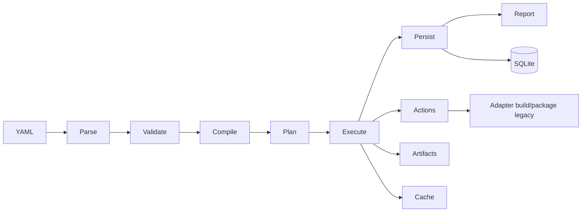

# Báo cáo triển khai ubuilder Pipeline

**Ngày báo cáo:** 23/11/2026  
**Dự án:** `C:/Users/gehihi/Documents/Projects/builder`  
**Phạm vi:** Nâng cấp `ubuilder` từ công cụ build desktop đa nền tảng thành workflow engine CI/CD cục bộ, khai báo bằng YAML qua `ubuilder pipeline`; bổ sung vận hành, bảo mật, phát hành và tài liệu production.  
**Trạng thái:** `PRODUCTION_READY_WITH_LIMITATIONS` trên Windows x64. Legacy `build` / `package` / `release` vẫn hoạt động.

---

## 1. Tóm tắt điều hành

Đã bổ sung một tầng pipeline hoàn chỉnh gồm bảy giai đoạn: **Parse → Validate → Compile → Plan → Execute → Persist → Report**. Tầng này tái sử dụng các adapter build/package, executor, cache, artifacts và storage sẵn có, không tạo engine build thứ hai.

Các kết quả chính:

- 14 lệnh con `ubuilder pipeline` hoạt động, tất cả hỗ trợ `--json`; thêm nhóm lệnh `secret`, `maintenance` và `daemon`.
- Workflow YAML có kiểm tra schema nghiêm ngặt, báo lỗi kèm dòng/cột.
- Matrix jobs, sóng phụ thuộc (`needs`), workspace cô lập, artifacts, cache, retry, timeout, hủy chéo tiến trình và phục hồi run bị treo.
- Fail-fast không còn serialize matrix; concurrency group dùng slot có giới hạn; vòng đời run/job/step được kiểm tra bằng state machine.
- Secret provider env/file, resolve fail-closed một lần mỗi run, redaction trên report/log/error/JSON.
- Cache theo step, artifact được băm lại và xác minh; retention có `stats/prune/gc/pin/unpin`.
- Action step lưu `stdout_tail` và log; daemon hỗ trợ polling, webhook loopback và chế độ `--once`.
- **139 bài kiểm thử đều đạt**; `cargo fmt`, `cargo clippy -D warnings` và `cargo build --release` sạch.
- Tài liệu kiến trúc, DSL, IR, runtime, bảo mật, actions, vận hành, phát hành và bộ `docs/production/` đã được viết.
- CI cho Windows, Ubuntu và macOS; release workflow tạo archive, checksum và SBOM CycloneDX.
- Mã nguồn đã được commit sạch trong Git tại `dc3de80`.

---

## 2. Khảo sát hiện trạng

### 2.1 Môi trường phát triển

| Thành phần | Giá trị / trạng thái |
| --- | --- |
| Hệ điều hành | Windows 10.0.26300, x64 |
| Rust / Cargo | 1.99.1 stable |
| Target đã cài | `x86_64-pc-windows-msvc`, `x86_64-unknown-linux-gnu` |
| .NET SDK | 10.0.404 và 11.0.100 |
| Node.js | v26.13.1, kèm npm, npx, bun |
| Công cụ có sẵn | git, tar |
| Linker native | **Không có** `gcc`, `clang`, `lld-link`, `link.exe` trên `PATH` |
| Công cụ macOS | Không có `codesign`, `lipo`, `hdiutil`, `osxcross` |
| Công cụ đóng gói khác | Không có `makensis`, `zip`, `rpmbuild`, `dpkg-deb`, `appimagetool`, `wine`, `zig`, `cross` |

Hệ quả: build Rust trên Windows vẫn thành công vì `rustc` tự tìm được linker nội bộ, nhưng `pipeline plan` phát cảnh báo `linker-unverified` cho mọi job. Các target chéo và macOS chưa thể kiểm chứng end-to-end trên máy này.

Cross-build Linux đã được thử và dừng ở linker:

```text
error occurred in cc-rs: failed to find tool "x86_64-linux-gnu-gcc": program not found
```

Do đó báo cáo không tuyên bố có binary Linux hoặc macOS.

### 2.2 Cấu trúc mã nguồn

Tại thời điểm báo cáo:

| Hạng mục | Số lượng |
| --- | --- |
| Tệp được Git theo dõi | 133 |
| Tệp Rust | 87 |
| Dòng Rust | khoảng 26.800 |
| Tệp tài liệu Markdown | 24 |
| Bộ kiểm thử tích hợp | 5 |

Các module chính:

```text
src/cli              command parsing, JSON envelope
src/config           ubuilder.toml
src/detect           nhận diện framework
src/target           target chuẩn và triple
src/host             thông tin host
src/providers        facts và provisioning toolchain
src/planner          project → build plan
src/builder          điều phối build/package/release
src/adapters         Rust, .NET, Electron, Tauri
src/executor         chạy tiến trình, log, timeout, hủy
src/scheduler        scheduler legacy
src/cache            action cache
src/artifacts        đóng gói, manifest
src/validation       kiểm tra định dạng/kiến trúc artifact
src/signing          hook ký
src/storage          SQLite history và lease
src/security         containment, lọc env, redaction
src/telemetry        output người đọc và JSON
```

Tầng pipeline và vận hành:

```text
src/pipeline/parser       đọc YAML, giới hạn 1 MiB
src/pipeline/schema       model serde, deny_unknown_fields
src/pipeline/validator    kiểm tra ngữ nghĩa, gom diagnostics
src/pipeline/compiler     schema → IR, topological sort, waves
src/pipeline/matrix       Cartesian expansion + include/exclude
src/pipeline/expression   lexer/parser/evaluator cho template và if
src/pipeline/planner      phân giải capability của host, cache capability
src/pipeline/runtime      scheduler sóng, workspace, fail-fast, concurrency
src/pipeline/state        RunState, transition table, kiểm tra chuyển trạng thái
src/pipeline/history      status/logs/cancel/recover
src/pipeline/artifacts    content-addressed storage, verify, containment
src/pipeline/cache        cache workspace theo step
src/pipeline/actions      11 built-in actions, action output
src/pipeline/events       event tiến trình
src/pipeline/graph        Mermaid / DOT / JSON
src/secrets               env/file provider, SecretValue, redaction
src/cli/pipeline_cmd      CLI pipeline và JSON envelope
src/cli/secret_cmd        secret list/set/delete/inspect
src/cli/maintenance       stats/prune/gc/pin/unpin
src/cli/daemon            start/stop/status/run/trigger
```

Release và vận hành:

```text
scripts/package.py        archive tất định cho Windows/Linux/macOS
scripts/checksums.py      SHA256SUMS từ đúng byte phát hành
scripts/sbom.py           CycloneDX 1.5 từ cargo metadata --locked
.github/workflows/ci.yml  fmt, clippy, test, release build trên 3 hệ điều hành
.github/workflows/release.yml  build, SBOM, checksum, publish
docs/production/          audit, threat model, risk, runbook, release, verdict
```

### 2.3 Hiện trạng kiểm thử ban đầu

Trước khi mở rộng pipeline, bộ kiểm thử gồm 74 bài: 65 unit test, 6 CLI, 1 real build, 2 compatibility. Các bài này là nền tảng để đảm bảo legacy không bị phá vỡ.

Trong quá trình khảo sát, các vấn đề sau được phát hiện:

| Vấn đề | Ảnh hưởng | Cách xử lý |
| --- | --- | --- |
| `matrix.include` thay thế toàn bộ combinations | Mất các tổ hợp không khớp, ví dụ mất `os: windows` | Merge tại chỗ vào tổ hợp tương thích; chỉ append khi không có tổ hợp nào khớp |
| Test parser kỳ vọng sai dòng lỗi | Test đỏ dù thông báo đúng | Sửa kỳ vọng về `workflow.yml:3` |
| `continue-on-error` đổi `status` thành `success` | Mất tín hiệu lỗi của step | Giữ `status: failure`, chỉ đặt `conclusion: success` |
| Không hỗ trợ `-` trong identifier biểu thức | Không đọc được `steps.cache.outputs.cache-hit` | Cho phép `-` trong identifier |
| Matrix `target: native` bị parse thành target lạ | Lỗi `UNSUPPORTED_TARGET` | Coi `native` / `auto` là target của host |
| Test runtime hard-code `windows-x64` | CI Ubuntu sẽ thất bại | Dùng `target: [native]` |
| Clippy còn 6 cảnh báo | CI `-D warnings` đỏ | Sửa closure, slice, `match`, thêm allow hợp lý |
| `.gitignore` có `**/target` và `dist` quá rộng | Commit đầu bỏ sót `src/target/mod.rs` và `fixtures/tauri-app/dist/index.html` | Thu hẹp pattern; commit bổ sung |

---

## 3. Công việc đã thực hiện

### 3.1 Sửa lỗi lõi

**Matrix include**

Cài đặt cũ gán `combinations = additions`, nên chỉ còn các tổ hợp khớp với include đầu tiên. Cài đặt mới duyệt từng tổ hợp, merge nếu không xung đột khóa, giữ nguyên tổ hợp không khớp và chỉ thêm tổ hợp mới khi include không khớp bất kỳ tổ hợp nào. Thứ tự vẫn deterministic theo `IndexMap`; giới hạn 256 job được giữ nguyên.

**Fail-fast**

Bản đầu tiên đặt semaphore nội bộ bằng 1 khi `fail-fast: true` và không có `max-parallel`, khiến các sibling chạy tuần tự. Đợt hardening đã bỏ giới hạn này: giới hạn là `job.max_parallel.unwrap_or(available_parallelism().max(2)).max(1)`. Fail-fast chỉ ngăn **lập lịch sibling mới**; sibling đang chạy được hoàn tất. Test `fail_fast_does_not_serialize_matrix_siblings` xác nhận hai job 2 giây hoàn thành dưới 4 giây.

**Timeout và song song**

Test timeout dùng `duration_ms` của report thay vì đồng hồ tiến trình, vì khởi động CLI mất khoảng 6 giây trên máy có antivirus. Executor hủy process tree sau khoảng 1 giây; test xác nhận step dưới 8 giây. Test song song xác nhận hai job 2 giây hoàn thành dưới 4 giây theo report.

**`continue-on-error`**

Trước đây runtime đặt `execution.status = "success"`, sau đó suy ra `conclusion` từ status nên mất thông tin thất bại. Nay step giữ `status: failure`, `conclusion: success`; job tiếp tục và không bị đánh dấu thất bại.

**Biểu thức có dấu gạch nối**

Lexer chỉ chấp nhận chữ, số và `_`. Các output như `cache-hit` bị hiểu là phép trừ và sinh lỗi `unexpected character '-'`. Lexer nay chấp nhận `-` trong identifier; đã có unit test và integration test cho luồng `needs` → `outputs` → `steps`.

**Target `native`**

Compiler gọi `Target::parse("native")` và trả `UNSUPPORTED_TARGET`. Nay compiler bỏ qua giá trị `native` / `auto` trước khi parse, fallback về target native của host. Plan và runtime đều dùng được.

**Workspace và artifact**

- `package::target` bỏ qua `native` / `auto`.
- `resolve_workspace_path` chỉ kiểm tra containment khi canonicalize thành công.
- Checkout loại trừ `.git`, `target`, `node_modules`, `.ubuilder`, `dist`, `dist-smoke`.
- Artifact lưu theo SHA-256, có manifest và kiểm tra tên an toàn.

### 3.2 Hardening production

| Hạng mục | Thay đổi | Kiểm chứng |
| --- | --- | --- |
| Secrets | `EnvironmentSecretProvider` và `FileSecretProvider`; `SecretValue` che giá trị khi Debug; file dùng lock, temp + rename, quyền `0600`/`0700` trên Unix | `missing_secret_fails_closed_before_running_jobs`, `secrets_are_injected_and_redacted_everywhere`, `secret_cli_never_prints_values` |
| State machine | `RunState` 11 trạng thái; bảng chuyển trạng thái hợp lệ; validate trong transaction khi ghi run/job/step | `terminal_run_state_cannot_transition_back_to_running` |
| Cache | Key = SHA-256 của `pipeline/v1/<host>\n<user_key>`, phạm vi step; workflow digest không còn làm mất cache | `cache_survives_unrelated_workflow_edits` |
| Artifacts | Băm lại trước upload, verify object, staging trước publish, chặn symlink thoát khỏi root | Unit test artifact và `copy_tree_rejects_symlinks_escaping_the_root` (Unix) |
| Concurrency | Bảng slot theo group; `cancel-in-progress` ghi cancel marker cho run khác đang giữ slot | `concurrency_group_serializes_jobs_without_deadlock` |
| Retention | `maintenance stats/prune/gc/pin/unpin`; giữ run terminal mới nhất, bỏ qua run đang chạy, bảo vệ artifact được pin | `maintenance_prune_keeps_newest_runs_and_protects_active`, `maintenance_pin_protects_and_gc_removes_unreferenced_objects` |
| Action output | `run_step_once` nhận log dir thật; lưu `stdout_tail` đã redact và `log_path` | `action_steps_capture_message_output` |
| Hiệu năng | Cache facts toolchain 30 giây; planner cache capability theo target; thêm Criterion benchmark | `benches/pipeline.rs` |
| Daemon | `daemon start/stop/status/run/trigger`; polling fingerprint, webhook loopback POST kèm token tùy chọn, chế độ `--once` | `daemon_once_runs_the_workflow_and_records_state`; kiểm tra thủ công webhook 401/405/202 |
| Release | CI 3 hệ điều hành; release workflow tạo archive, checksum, SBOM, hook ký tùy chọn | `dist/` cục bộ đã verify |

**Secrets.** Tên secret được trích từ IR và resolve đúng một lần trước job đầu tiên; thiếu tên nào thì run fail-closed. Giá trị thô chỉ nằm trong bộ nhớ để phục vụ `needs.*.outputs`; mọi bề mặt serialize đều dùng `***`. `secret set --value` vẫn lộ giá trị trong argv, nên khuyến nghị `--stdin` hoặc prompt.

**State machine.** Các chuỗi cũ `queued`, `success`, `failure`, `timed_out`, `interrupted` vẫn được đọc để tương thích dữ liệu đã lưu, nhưng chuyển trạng thái không hợp lệ bị từ chối với `STATE_INVALID`.

**Retention.** Prune xếp run mới nhất trước, chỉ xóa run terminal, không xóa run đang chạy. Pin bảo vệ artifact khỏi GC cho đến khi `unpin`.

**Daemon.** Mỗi trigger được giao cho một tiến trình con `ubuilder pipeline run --file <workflow>` để chỉ có một runtime. Cron được giao cho scheduler của hệ điều hành; daemon không tạo scheduler thứ hai.

### 3.3 Bổ sung kiểm thử

Đã thêm các bài kiểm thử hành vi thực tế:

| Bài kiểm thử | Nội dung xác minh |
| --- | --- |
| `retry_policy_reruns_a_failed_job` | Job thất bại lần đầu, tự chạy lại và thành công |
| `continue_on_error_keeps_the_job_running` | Step lỗi có `status=failure`, `conclusion=success`, job chạy tiếp |
| `job_outputs_flow_through_the_needs_context` | Output của job trước được job sau đọc qua `needs` |
| `recover_marks_an_interrupted_run_as_failed` | Kill tiến trình, `recover --stale-secs 0` chuyển run sang `failed` |
| `identifiers_allow_hyphenated_output_keys` | Biểu thức `steps.cache.outputs.cache-hit` hợp lệ |
| `cache_action_misses_then_hits_across_runs` | Lần đầu cache miss, lần sau cache hit |
| `matrix_fail_fast_skips_remaining_siblings` | Sibling chưa chạy bị `skipped` |
| `independent_jobs_run_in_parallel` | Hai job độc lập chạy song song |
| `two_jobs_transfer_artifacts_between_isolated_workspaces` | Upload ở job A, download ở job B với target `native` |
| `step_timeout_fails_the_job` | Timeout thực sự kill process tree |
| `cancel_command_stops_a_running_workflow` | Hủy chéo tiến trình, run kết thúc `cancelled` |
| `fail_fast_does_not_serialize_matrix_siblings` | Fail-fast giữ sibling chạy song song |
| `secrets_are_injected_and_redacted_everywhere` | Secret đến command nhưng report/log/status chỉ có `***` |
| `missing_secret_fails_closed_before_running_jobs` | Thiếu secret thì không job nào chạy |
| `secret_cli_never_prints_values` | `secret set/list/inspect` không lộ giá trị |
| `cache_survives_unrelated_workflow_edits` | Sửa job không liên quan không làm mất cache |
| `concurrency_group_serializes_jobs_without_deadlock` | Slot tuần tự hóa, không deadlock |
| `action_steps_capture_message_output` | Action step có output và log |
| `maintenance_prune_keeps_newest_runs_and_protects_active` | Prune giữ run mới nhất, bỏ qua run active |
| `maintenance_pin_protects_and_gc_removes_unreferenced_objects` | Pin bảo vệ artifact; GC chỉ xóa object không tham chiếu |
| `daemon_once_runs_the_workflow_and_records_state` | Chế độ `--once` chạy workflow và ghi state |

Ngoài ra, các helper test được làm cross-platform bằng `sleep_command`, `matrix_fail_fast_command`, `cache_fill_command`; test artifact dùng `native` thay vì target Windows cố định.

### 3.4 Tài liệu

Đã viết hoặc cập nhật:

| Tệp | Nội dung |
| --- | --- |
| `README.md` | Tổng quan, quick start, bảng lệnh, envelope JSON, exit code |
| `docs/ARCHITECTURE.md` | Kiến trúc legacy + pipeline, quy tắc phân tầng |
| `docs/PIPELINE_ARCHITECTURE.md` | Bảy giai đoạn, module, data flow, storage layout |
| `docs/PIPELINE_DSL.md` | Schema, jobs/steps, matrix, expression, retry, concurrency |
| `docs/PIPELINE_IR.md` | Cấu trúc IR thực tế, không suy diễn |
| `docs/PIPELINE_RUNTIME.md` | Lifecycle, isolation, scheduling, states, timeout, cache |
| `docs/PIPELINE_SECURITY.md` | Biên bảo mật, trust assumption, dữ liệu lưu trữ |
| `docs/PIPELINE_ACTIONS.md` | 11 built-in actions, input/output, lưu ý |
| `docs/PIPELINE_EXAMPLES.md` | Ví dụ matrix, cache, conditional release, concurrency |
| `docs/PIPELINE_IMPLEMENTATION_STATUS.md` | Trạng thái đã kiểm chứng, phần chưa kiểm chứng |
| `examples/native-matrix.yml` | Workflow mẫu chạy được với target native |

Bộ tài liệu production trong `docs/production/`:

| Tệp | Nội dung |
| --- | --- |
| `BASELINE_AUDIT.md` | Audit hiện trạng, lệnh và công cụ đo được |
| `ARCHITECTURE_REVIEW.md` | Đánh giá kiến trúc, scheduler, storage, CLI |
| `SECURITY_THREAT_MODEL.md` | Tài sản, tác nhân, biên tin cậy, rủi ro còn lại |
| `RISK_REGISTER.md` | Rủi ro, mức độ, biện pháp và trạng thái |
| `GAP_ANALYSIS.md` | Khoảng trống so với yêu cầu production |
| `PRODUCTION_ROADMAP.md` | Phạm vi và thứ tự triển khai |
| `CROSS_PLATFORM_MATRIX.md` | Bằng chứng Windows, Linux, macOS |
| `PERFORMANCE_BASELINE.md` | Phương pháp đo và kết quả benchmark |
| `SECURITY_TEST_REPORT.md` | Kiểm thử bảo mật và residual findings |
| `RELEASE_PROCESS.md` | Gate, phiên bản, artifact, ký, SBOM |
| `OPERATIONS_RUNBOOK.md` | Vận hành, chẩn đoán, retention, daemon |
| `MIGRATION_GUIDE.md` | Tương thích legacy và dữ liệu cũ |
| `FINAL_READINESS_REPORT.md` | Kết luận `PRODUCTION_READY_WITH_LIMITATIONS` |

Tài liệu ưu tiên **chỉ ghi điều đã kiểm chứng**. Các mục Linux/macOS, cross-compile, ký và dependency audit được đánh dấu rõ là chưa chạy end-to-end.

### 3.5 CI, release, ví dụ và vệ sinh repository

- `.github/workflows/ci.yml` chạy `fmt`, `clippy -D warnings`, `test --all-targets --locked` và `build --release --locked` trên `windows-latest`, `ubuntu-latest`, `macos-latest`.
- `.github/workflows/release.yml` chạy khi tag `v*` hoặc dispatch; job `build` tạo archive từng nền tảng, job `sbom` tạo CycloneDX, job `publish` gộp checksum và phát hành.
- `scripts/package.py` tạo archive tất định; `scripts/checksums.py` tạo `SHA256SUMS`; `scripts/sbom.py` tạo SBOM từ `cargo metadata --locked`.
- Thêm workflow mẫu `examples/native-matrix.yml`; đã validate và plan thành công, cho ra ba sóng `test` → `build[target=native]` → `summary`.
- Xóa các thư mục sinh tạm: `.tmp-pipeline`, `.tmp-e2e`, `dist-smoke`, `doctor.json`, `.tmp-ir.json`, `fixtures/*/target`, `fixtures/*/.ubuilder`, `fixtures/dotnet-console/{bin,obj}`.
- Thu hẹp `.gitignore` để không bỏ sót mã nguồn tên `target` và tài nguyên `fixtures/tauri-app/dist`.
- Commit sạch, không còn thay đổi chưa theo dõi ngoài thư mục sinh tự động.

---

## 4. Kiến trúc và luồng thực thi



Các bất biến đã giữ:

- Parser và compiler không chạy tiến trình, không chạm workspace.
- Planner không có side effect.
- Runtime chỉ nhận IR, không đọc YAML.
- Biểu thức là interpreter cố định; không shell, JavaScript hay `eval`.
- Thứ tự đến từ `IndexMap` và topological sort, không từ hash iteration.
- Mọi lỗi là `UbuilderError` với `ErrorCode`, `remediation`, `details`.

Giới hạn tài nguyên:

| Thành phần | Giới hạn |
| --- | --- |
| Kích thước workflow | 1 MiB |
| Matrix jobs | 256 mặc định, tối đa 1024 |
| Độ dài biểu thức | 4096 byte |
| Token biểu thức | 1024 |
| Độ sâu AST | 64 |
| Số node AST | 512 |
| Bước eval | 10.000 |
| Retry | 1–10 lần |
| Concurrency max | 64 |
| Run id | 96 ký tự an toàn |

---

## 5. Kết quả kiểm thử

### 5.1 Lệnh đã chạy

| Lệnh | Kết quả |
| --- | --- |
| `cargo fmt --all -- --check` | Đạt |
| `cargo clippy --all-targets -- -D warnings` | Đạt, không cảnh báo |
| `cargo test --all-targets --locked` | **139/139 đạt**, 102,34 giây |
| `cargo build --release --locked` | Đạt |

### 5.2 Phân bố kiểm thử

| Bộ kiểm thử | Số bài | Kết quả |
| --- | ---: | --- |
| Unit test thư viện | 100 | Đạt |
| `tests/builds.rs` | 1 | Đạt |
| `tests/cli.rs` | 6 | Đạt |
| `tests/compatibility.rs` | 2 | Đạt |
| `tests/pipeline_contract.rs` | 7 | Đạt |
| `tests/pipeline_runtime.rs` | 23 | Đạt |
| **Tổng** | **139** | **Đạt** |

### 5.3 Benchmark

Đo bằng `benches/pipeline.rs` (Criterion), workflow 12 job với matrix 4 tổ hợp, tổng 48 job:

| Benchmark | Kết quả |
| --- | ---: |
| Parse + validate | 234,69 µs |
| Compile + expand | 403,61 µs |
| Plan 48 job, warm | 71,31 ms |
| Plan 48 job, cold | khoảng 4,5 s |

Cold plan chậm do probe toolchain; facts được cache 30 giây trong cùng tiến trình.

### 5.4 Kiểm chứng thủ công

- `pipeline validate` trên `examples/native-matrix.yml`: không có diagnostic.
- `pipeline plan`: đúng ba sóng, id `test`, `build[target=native]`, `summary`; cảnh báo `linker-unverified` đúng với môi trường thiếu linker.
- Chạy workflow thật trên fixture Rust: build, package, upload/download artifact, checksum, cache, retry, timeout, cancel, recover đều cho kết quả đúng.
- JSON envelope: thành công `{"ok":true,...}`; lỗi có `code`, `message`, `remediation`, `details`.
- Exit code: `0` thành công, `1` lỗi thực thi, `2` usage, `3` cấu hình/toolchain, `130` bị hủy.
- Daemon: `start` → `status` running → `stop` → `status` không còn pid; webhook trả `401` khi thiếu token, `405` khi sai method, `202` khi hợp lệ và run hoàn tất.
- Release binary `dist/ubuilder.exe --version` trả `ubuilder 0.1.0`; `doctor --json` trả envelope hợp lệ.
- `sha256sum -c dist/SHA256SUMS`: cả `ubuilder-windows-x64.zip` và `sbom.cdx.json` đều OK.

Artifact phát hành cục bộ:

| Tệp | Kích thước | SHA-256 |
| --- | ---: | --- |
| `ubuilder-windows-x64.zip` | 3,6 MiB | `7b18aca911391849b3de0035ee1173be76b9ceab14d3972fdbc81c9eb911b65a` |
| `sbom.cdx.json` | 98 KiB | `b3ba576aec19310f886f956aa51233accf809044044f5de977d533e5ead0cea2` |

Archive có 24 entry và chứa `ubuilder.exe`. SBOM là CycloneDX 1.5 với 168 component và 168 dependency node. `dist/` được ignore, không commit.

### 5.5 Bằng chứng đa nền tảng

| Nền tảng | Build | Test | Fixture native | Bằng chứng |
| --- | --- | --- | --- | --- |
| Windows x64 | Đạt | 139/139 | Đạt | Máy hiện tại |
| Linux x64 | **Chưa xác minh** | CI đã cấu hình | Chưa chạy | Cross build thiếu `x86_64-linux-gnu-gcc` |
| macOS | **Chưa xác minh** | CI đã cấu hình | Chưa chạy | Không có host/SDK; CI chưa chạy thực tế |

Không có binary Linux hoặc macOS nào được tuyên bố trong báo cáo này.

---

## 6. Bảo mật

| Kiểm soát | Bằng chứng |
| --- | --- |
| Secret chỉ resolve tên được tham chiếu, fail-closed trước job đầu tiên | `missing_secret_fails_closed_before_running_jobs` |
| Secret đến command nhưng bị redact ở report, output, status và JSON | `secrets_are_injected_and_redacted_everywhere` |
| CLI secret không in giá trị thô | `secret_cli_never_prints_values` |
| Artifact được băm lại, manifest được xác minh | Unit test artifact và build fixture |
| Chặn ZIP traversal | `cache::tests::extraction_rejects_traversal_entries` |
| Chặn symlink thoát khỏi root | `copy_tree_rejects_symlinks_escaping_the_root` (`cfg(unix)`) |
| Run terminal không quay lại `running` | `storage::tests::terminal_run_state_cannot_transition_back_to_running` |
| Retention không xóa run active hoặc artifact được pin | Hai integration test maintenance |
| Webhook chỉ loopback, POST, token tùy chọn | Kiểm tra thủ công `401` / `405` / `202` |

Residual findings:

- Workspace là ranh giới thư mục, không phải OS sandbox; workflow tin cậy chạy với quyền người dùng.
- File secret trên Windows dựa vào ACL kế thừa; trên Unix được đặt `0600` và thư mục `0700`.
- `secret set --value` lộ giá trị trong argv; dùng `--stdin` hoặc prompt.
- Webhook không có TLS, rate limit hoặc replay window; chỉ dùng loopback.
- Chưa chạy `cargo-audit` / `cargo-deny`; SBOM là inventory, không phải vulnerability scan.
- Chưa có code signing, macOS notarization hoặc release công khai.

---

## 7. Hạn chế và rủi ro còn lại

| Hạn chế | Mức độ | Trạng thái / ghi chú |
| --- | --- | --- |
| Linux chưa chạy end-to-end | Trung bình | CI đã cấu hình Ubuntu; cross build thiếu linker |
| macOS chưa kiểm chứng | Trung bình | Không có host/SDK; CI chưa chạy thực tế |
| Cross-compile phụ thuộc linker/SDK | Trung bình | Báo `linker-unverified`, không giả thành công |
| OS sandbox | Trung bình | Chưa có `IsolationProvider`; workflow không tin cậy chưa được cô lập |
| Dependency audit | Trung bình | `cargo-audit` / `cargo-deny` chưa cài; SBOM đã có |
| Ký và notarization | Trung bình | Chỉ có hook `UBUILDER_SIGN_COMMAND`; chưa có credential |
| CI/release chưa chạy thật | Trung bình | Workflow đã viết nhưng chưa được GitHub Actions thực thi |
| Daemon start/stop/webhook | Thấp | Webhook kiểm tra thủ công; chỉ `--once` có test tự động |
| `cancel-in-progress` | Thấp | Dùng cancel marker; chưa có test riêng |
| Concurrency slot sau crash | Thấp | Thu hồi bằng lease 1 giờ, chưa có heartbeat |
| SQLite schema mới hơn | Thấp | Chưa từ chối version cao hơn |
| Action từ xa, container/WSL, installer native | Thấp | Chưa triển khai; planner báo capability |

Rủi ro vận hành chính: pipeline chạy lệnh tùy ý với quyền người dùng. Workspace cô lập ngăn ghi đè giữa job nhưng không ngăn tiến trình cố ý ghi ra ngoài. Với workflow không tin cậy, cần OS sandbox trước khi dùng production.

---

## 8. Đề xuất tiếp theo

1. **Chạy CI thực tế trên Ubuntu và macOS** để xác nhận Linux/macOS end-to-end và chạy test symlink `cfg(unix)`.
2. **Chạy release workflow bằng tag thử** để xác nhận archive, checksum, SBOM và publish trên GitHub.
3. **Thêm dependency audit** (`cargo-audit`/`cargo-deny`) vào CI cùng SBOM.
4. **Bổ sung OS sandbox** cho workflow không tin cậy: container/WSL, Windows Job Object hoặc backend tương đương.
5. **Thêm signing/notarization thật** cho Windows và macOS; công bố artifact kèm chữ ký kiểm chứng được.
6. **Tự động hóa test daemon** `start/stop/webhook` trong CI, kèm TLS reverse-proxy guidance.
7. **Thêm test riêng cho `cancel-in-progress`** giữa hai run thực sự chạy song song.
8. **Thêm heartbeat cho concurrency slot** để thu hồi sớm sau crash thay vì chờ lease 1 giờ.
9. **Từ chối SQLite schema mới hơn** và bổ sung migration/rollback có kiểm thử.
10. **Kiểm thử cross-compile có điều kiện** khi linker/SDK tồn tại; giữ hành vi báo lỗi rõ ràng khi thiếu.

---

## 9. Commit

| Commit | Nội dung |
| --- | --- |
| `81fa5e5` | `feat: add local-first declarative pipeline engine` — engine, action, test, tài liệu, CI |
| `aa17665` | `fix: track target module and Tauri fixture assets` — sửa `.gitignore`, bổ sung module và fixture |
| `73bfc31` | `docs: add Vietnamese implementation report` — báo cáo triển khai ban đầu |
| `dc3de80` | `feat: production hardening for pipeline engine` — fail-fast, secrets, state, cache, artifacts, retention, daemon, benchmark, release và docs production |

Báo cáo này được cập nhật sau `dc3de80`. Sau khi commit tài liệu, repository sạch; `dist/` và các thư mục sinh tự động vẫn được ignore.

---

## 10. Kết luận

Tầng pipeline đã đạt mục tiêu: khai báo bằng YAML, thực thi cục bộ có cô lập, tái sử dụng engine build sẵn có, lưu lịch sử và báo cáo có cấu trúc. Legacy build không bị ảnh hưởng.

Trên Windows x64, các gate đã chạy thật:

- 139/139 bài kiểm thử đạt.
- `fmt`, `clippy -D warnings`, `build --release` đạt.
- Benchmark có số đo cụ thể; release artifact và checksum đã được xác minh.

Kết luận: **`PRODUCTION_READY_WITH_LIMITATIONS`**. Chưa thể tuyên bố `PRODUCTION_READY` đầy đủ vì Linux/macOS chưa chạy thật, dependency audit và OS sandbox chưa có, signing/notarization chưa có credential, và GitHub Actions chưa thực thi trong môi trường này. Mọi giới hạn đều được nêu rõ thay vì tuyên bố quá mức.
