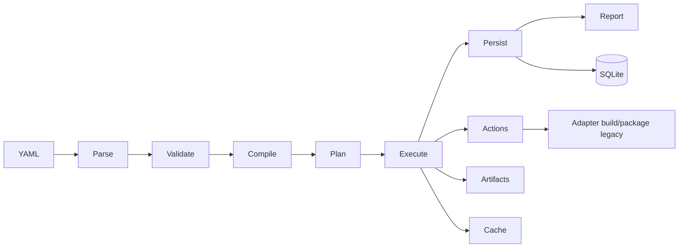

# Báo cáo triển khai ubuilder Pipeline

**Ngày báo cáo:** 23/11/2026  
**Dự án:** `C:/Users/gehihi/Documents/Projects/builder`  
**Phạm vi:** Nâng cấp `ubuilder` từ công cụ build desktop đa nền tảng thành workflow engine CI/CD cục bộ, khai báo bằng YAML qua `ubuilder pipeline`; bổ sung vận hành, bảo mật, phát hành và tài liệu production.  
**Trạng thái:** `PRODUCTION_READY_WITH_LIMITATIONS` trên Windows x64, chế độ chạy native tin cậy. Legacy `build` / `package` / `release` vẫn hoạt động.

Báo cáo này là bản cuối sau finalization. Nguồn chuẩn cho từng tuyên bố là repository và các tệp bằng chứng, không phải báo cáo cũ:

- `docs/production/FINAL_READINESS_REPORT.md` — kết luận và phạm vi.
- `docs/production/READINESS_GATES.json` — 10 gate G01–G10.
- `docs/production/READINESS_EVIDENCE.md` — lệnh, log, số test.
- `docs/production/RELEASE_VERIFICATION.md` — hash, smoke test, tính tái lập.
- `docs/production/FINALIZATION_FINDINGS.md` — F-01…F-16.

Commit mã nguồn cuối: `a4cd66d0e206670872a81622d8742231c316dd42`.  
Artifact phát hành được đóng từ commit tài liệu `bb2708c90440e014df74a32b8dd3bb5681b8e4b4`.  
HEAD tài liệu tại thời điểm viết: `8c640831a6230014a00558905f43bdfe4546d814`.

---

## 1. Tóm tắt điều hành

Đã bổ sung một tầng pipeline hoàn chỉnh gồm bảy giai đoạn: **Parse → Validate → Compile → Plan → Execute → Persist → Report**. Tầng này tái sử dụng adapter build/package, executor, cache, artifacts và storage sẵn có; không có engine build thứ hai.

Kết quả chính:

- 14 lệnh con `ubuilder pipeline`, tất cả hỗ trợ `--json`; thêm nhóm `secret`, `maintenance`, `daemon`.
- YAML có schema nghiêm ngặt, lỗi kèm dòng/cột; giới hạn alias, matrix, biểu thức và kích thước tài liệu.
- Matrix, sóng phụ thuộc, workspace theo job, artifacts, cache, retry, timeout, hủy chéo tiến trình và phục hồi run bị treo.
- Fail-fast không serialize sibling; concurrency dùng slot có fencing, lease 60 giây và heartbeat 15 giây.
- Secret provider env/file, resolve fail-closed, scope theo từng job, redaction trên report/log/error/JSON; ACL Windows được siết.
- Artifact băm lại và xác minh; chống escape bằng junction/symlink; retention có `stats/prune/gc/pin/unpin`.
- Daemon có lifecycle, polling, webhook loopback bắt buộc token, rate limit và replay cache; có test tích hợp.
- `doctor --all` chẩn đoán đủ 7 target trong một envelope.
- **172 bài kiểm thử đạt**, 0 thất bại; `fmt`, `clippy --locked -D warnings`, `build --release --locked` đều đạt.
- Artifact Windows x64, SBOM, manifest và `SHA256SUMS` đã được tạo, kiểm tra và smoke test từ archive đã giải nén.
- CI cho Windows/Ubuntu/macOS và release workflow đã được cấu hình nhưng **chưa chạy** trong môi trường này.

Giới hạn không được che giấu: Linux/macOS/ARM64 chưa thực thi, isolated execution chưa có backend được chứng nhận, dependency audit và ký số chưa chạy, warm planning tăng so với baseline.

---

## 2. Khảo sát hiện trạng

### 2.1 Môi trường phát triển

| Thành phần | Giá trị / trạng thái |
| --- | --- |
| Hệ điều hành | Windows 10.0.26300, x64 |
| CPU logic | 16 |
| Rust / Cargo | 1.99.1 stable |
| Target đã cài | `x86_64-pc-windows-msvc`, `x86_64-unknown-linux-gnu` |
| .NET SDK | 10.0.404 và 11.0.100 |
| Node.js | v26.13.1, kèm npm, npx, bun |
| Python | 3.13.17 |
| Linker native trên `PATH` | Không có `gcc`, `clang`, `lld-link`, `link.exe`; `rustc` vẫn tự tìm được linker MSVC nội bộ |
| Công cụ macOS | Không có `codesign`, `lipo`, `hdiutil`, `osxcross` |
| Thiếu cho release/audit | `signtool`, `cargo-audit`, `cargo-deny`, `cargo-nextest`, `cargo-fuzz` |
| Thiếu cho sandbox | `bwrap`, `firejail`, `sandbox-exec`, backend Windows được chứng nhận |
| Thiếu cho cross/package | `zig`, `cross`, `electron-builder`, `tauri`, `makensis` |

Hệ quả: Rust build trên Windows thành công, nhưng `doctor --target windows-x64` vẫn báo compilation `CONDITIONAL` (`linker-unverified`) vì linker không có trên `PATH`. Các target chéo và macOS chưa được kiểm chứng end-to-end.

Cross-build Linux đã được thử và dừng ở linker:

```text
error occurred in cc-rs: failed to find tool "x86_64-linux-gnu-gcc": program not found
```

Báo cáo không tuyên bố có binary Linux, macOS hoặc ARM64.

### 2.2 Cấu trúc mã nguồn hiện tại

| Hạng mục | Số lượng |
| --- | --- |
| Tệp được Git theo dõi | 142 |
| Tệp Rust | 89 |
| Dòng Rust | 29.275 |
| Tệp Markdown | 28 |
| Bộ kiểm thử tích hợp | 6 (`builds`, `cli`, `compatibility`, `daemon`, `pipeline_contract`, `pipeline_runtime`) |

Các module chính:

```text
src/cli              command parsing, JSON envelope
src/config           ubuilder.toml
src/detect           nhận diện framework
src/target           target chuẩn và triple
src/host             thông tin host
src/providers        facts và provisioning toolchain
src/planner          project → build plan
src/builder          điều phối build/package/release
src/adapters         Rust, .NET, Electron, Tauri
src/executor         chạy tiến trình, log, timeout, hủy
src/scheduler        scheduler legacy
src/cache            action cache
src/artifacts        đóng gói, manifest
src/validation       kiểm tra định dạng/kiến trúc artifact
src/signing          hook ký
src/storage          SQLite history, schema, lease
src/security         containment, lọc env, redaction
src/telemetry        output người đọc và JSON
```

Tầng pipeline và vận hành:

```text
src/pipeline/parser       đọc YAML, giới hạn 1 MiB, chống alias bomb
src/pipeline/schema       model serde, deny_unknown_fields
src/pipeline/validator    kiểm tra ngữ nghĩa, gom diagnostics
src/pipeline/compiler     schema → IR, topological sort, waves
src/pipeline/matrix       Cartesian expansion + include/exclude, giới hạn job
src/pipeline/expression   lexer/parser/evaluator cho template và if
src/pipeline/planner      phân giải capability, cache capability theo target
src/pipeline/runtime      scheduler sóng, workspace, fail-fast, concurrency
src/pipeline/state        RunState, transition table
src/pipeline/history      status/logs/cancel/recover
src/pipeline/artifacts    content-addressed storage, verify, safe_join
src/pipeline/cache        cache workspace theo step, key phân lớp
src/pipeline/actions      11 built-in actions, action output
src/pipeline/events       event tiến trình
src/pipeline/graph        Mermaid / DOT / JSON
src/pipeline/isolation    TrustMode, IsolationPolicy, provider selection
src/secrets               env/file provider, SecretValue, ACL, redaction
src/cli/pipeline_cmd      CLI pipeline và JSON envelope
src/cli/secret_cmd        secret list/set/delete/inspect
src/cli/maintenance       stats/prune/gc/pin/unpin
src/cli/daemon            start/stop/status/run/trigger
```

Release và vận hành:

```text
scripts/package.py        archive tất định cho Windows/Linux/macOS
scripts/checksums.py      SHA256SUMS từ đúng byte phát hành
scripts/sbom.py           CycloneDX 1.5 từ cargo metadata --locked
scripts/manifest.py       manifest: commit, size, hash, SBOM, ký, smoke test
.github/workflows/ci.yml  fmt, clippy, test, release build trên 3 hệ điều hành
.github/workflows/release.yml  build 4 target, SBOM, manifest, checksum, publish
docs/production/          audit, threat model, risk, runbook, gate, verdict
```

### 2.3 Hiện trạng kiểm thử ban đầu

Trước khi mở rộng pipeline, bộ kiểm thử gồm 74 bài: 65 unit, 6 CLI, 1 real build, 2 compatibility. Đây là baseline để bảo vệ legacy.

Các vấn đề phát hiện trong khảo sát ban đầu:

| Vấn đề | Ảnh hưởng | Cách xử lý |
| --- | --- | --- |
| `matrix.include` thay thế toàn bộ combinations | Mất tổ hợp không khớp, ví dụ `os: windows` | Merge tại chỗ; chỉ append khi không có tổ hợp nào khớp |
| Test parser kỳ vọng sai dòng lỗi | Test đỏ dù thông báo đúng | Sửa kỳ vọng về `workflow.yml:3` |
| `continue-on-error` đổi `status` thành `success` | Mất tín hiệu lỗi của step | Giữ `status: failure`, đặt `conclusion: success` |
| Không hỗ trợ `-` trong identifier | Không đọc được `steps.cache.outputs.cache-hit` | Cho phép `-` trong identifier |
| Matrix `target: native` bị parse thành target lạ | Lỗi `UNSUPPORTED_TARGET` | Coi `native` / `auto` là target của host |
| Test runtime hard-code `windows-x64` | CI Ubuntu sẽ thất bại | Dùng `target: [native]` |
| Clippy còn 6 cảnh báo | CI `-D warnings` đỏ | Sửa closure, slice, `match`, thêm allow hợp lý |
| `.gitignore` có `**/target` và `dist` quá rộng | Bỏ sót `src/target/mod.rs`, `fixtures/tauri-app/dist/index.html` | Thu hẹp pattern; commit bổ sung |

---

## 3. Công việc đã thực hiện

### 3.1 Sửa lỗi lõi

**Matrix include.** Cài đặt cũ gán `combinations = additions`, nên chỉ còn tổ hợp khớp include đầu tiên. Cài đặt mới duyệt từng tổ hợp, merge nếu không xung đột khóa, giữ tổ hợp không khớp và chỉ thêm tổ hợp mới khi include không khớp bất kỳ tổ hợp nào. Thứ tự deterministic theo `IndexMap`; giới hạn 256 job mặc định được giữ.

**Fail-fast.** Bản đầu đặt semaphore bằng 1 khi `fail-fast: true`, khiến sibling chạy tuần tự. Đợt hardening bỏ giới hạn này. Fail-fast chỉ ngăn **lập lịch sibling mới**; sibling đang chạy được hoàn tất. Với `max-parallel: 1`, sibling đang xếp hàng bị `skipped`; với parallelism không giới hạn, sibling đã chạy không thể bị hủy. Test dùng ba matrix entry để assertion deterministic.

**Timeout và song song.** Test timeout dùng `duration_ms` của report thay vì đồng hồ tiến trình, vì khởi động CLI có thể chậm trên máy có antivirus. Executor hủy process tree; test xác nhận step timeout thất bại. Test song song không còn dùng ngưỡng thời gian; nó so sánh mtime của marker start/end để chứng minh hai job thực sự chồng lấn.

**`continue-on-error`.** Runtime cũ đặt `execution.status = "success"`, sau đó suy ra `conclusion`, nên mất thông tin thất bại. Nay step giữ `status: failure`, `conclusion: success`; job tiếp tục và không bị đánh dấu thất bại.

**Biểu thức có dấu gạch nối.** Lexer cũ chỉ nhận chữ, số và `_`; `cache-hit` bị hiểu là phép trừ. Lexer nay nhận `-` trong identifier; có unit test và integration test cho `needs` → `outputs` → `steps`.

**Target `native`.** Compiler cũ gọi `Target::parse("native")` và trả `UNSUPPORTED_TARGET`. Nay compiler bỏ qua `native` / `auto` trước khi parse, fallback về target native của host.

**Workspace và artifact.** `package::target` bỏ qua `native` / `auto`; checkout loại trừ `.git`, `target`, `node_modules`, `.ubuilder`, `dist`, `dist-smoke`; artifact lưu theo SHA-256, có manifest và kiểm tra tên an toàn. Validation đường dẫn nay canonicalize cả prefix tồn tại để chặn junction/symlink escape.

### 3.2 Hardening production

| Hạng mục | Thay đổi cuối | Kiểm chứng |
| --- | --- | --- |
| Secrets | Env/file provider; `secrets_by_job` chỉ chứa tên job tham chiếu; resolve fail-closed; redaction toàn bộ; Windows `icacls /inheritance:r`, từ chối reparse point | `secrets_are_injected_and_redacted_everywhere`, `missing_secret_fails_closed_before_running_jobs`, `secret_scope_only_contains_names_the_job_references`, `windows_secret_file_has_no_inherited_aces` |
| Schema | Schema v2; DB mới hơn bị từ chối với `SCHEMA_UNSUPPORTED` (exit 3) trước DDL; backup `VACUUM INTO` trước migration; DDL trong `BEGIN IMMEDIATE` | `newer_schema_is_rejected_before_ddl`, `version_one_database_is_backed_up_and_migrated` |
| State machine | `RunState` 11 trạng thái; bảng chuyển trạng thái; validate trong transaction | `terminal_run_state_cannot_transition_back_to_running` |
| Cache | Key `sha256(pipeline/<namespace>/v1/<host>/<toolchain>\\n<user_key>)`; namespace gồm workflow + file; action cache thêm job id; workflow digest không còn làm mất cache | `identity_layers_change_the_key`, `cache_survives_unrelated_workflow_edits`, `extraction_rejects_traversal_entries`, `concurrent_writers_produce_one_valid_entry` |
| Artifacts | Băm lại trước upload; verify object; staging trước publish; `safe_join` chống `..`, absolute, junction, symlink | `corrupted_artifact_object_is_rejected_on_download`, `junction_escape_is_rejected`, `symlink_escape_is_rejected`, `lexical_containment_rejects_absolute_and_parent_paths` |
| Concurrency | Slot theo group; generation fencing; lease 60 s; heartbeat 15 s; mất lease thì hủy job; `cancel-in-progress` giải phóng slot | `expired_lease_cannot_be_renewed_or_released_by_the_old_owner`, `cancel_in_progress_cancels_the_holder_and_releases_its_lease`, `concurrency_group_serializes_jobs_without_deadlock` |
| Retention | `maintenance stats/prune/gc/pin/unpin`; giữ run terminal mới nhất, bỏ qua run active, bảo vệ artifact pin | `maintenance_prune_keeps_newest_runs_and_protects_active`, `maintenance_pin_protects_and_gc_removes_unreferenced_objects` |
| Action output | `run_step_once` nhận log dir thật; lưu `stdout_tail` đã redact và `log_path` | `action_steps_capture_message_output` |
| Hiệu năng | Cache facts toolchain 30 giây; planner cache capability theo target; Criterion benchmark | `benches/pipeline.rs`; số đo mục 5.3 |
| Daemon | `start/stop/status/run/trigger`; polling fingerprint; webhook bắt buộc token, loopback mặc định, giới hạn header/body/rate/replay; `--once` | 4 test trong `tests/daemon.rs` |
| Capability | `doctor --all`; thứ tự target chuẩn; báo `linker-unverified` thay vì giả thành công | `doctor_all_matches_the_explicit_target_list` |
| Isolation | `TrustMode`, `IsolationPolicy`, provider trait, native + Linux bubblewrap; `isolated` fail-closed nếu thiếu backend | `isolated_mode_fails_closed_without_a_backend` |
| Release | Archive theo platform/arch; manifest có commit/hash/size/SBOM/smoke; SBOM; checksum; signing hook | `RELEASE_VERIFICATION.md` |

**Secrets.** Tên secret được trích từ IR và resolve đúng một lần trước job đầu tiên; thiếu tên nào thì run fail-closed. Mỗi job chỉ nhận tên nó tham chiếu. Giá trị thô chỉ nằm trong bộ nhớ để phục vụ `needs.*.outputs`; mọi bề mặt serialize dùng `***`. `secret set --value` vẫn hoạt động nhưng bị deprecate và cảnh báo ở human mode; khuyến nghị `--stdin` hoặc prompt.

**State machine.** Chuỗi cũ `queued`, `success`, `failure`, `timed_out`, `interrupted` vẫn được đọc để tương thích dữ liệu đã lưu; chuyển trạng thái không hợp lệ bị từ chối với `STATE_INVALID`.

**Retention.** Prune xếp run mới nhất trước, chỉ xóa run terminal, không xóa run đang chạy. Pin bảo vệ artifact khỏi GC đến khi `unpin`.

**Daemon.** Mỗi trigger được giao cho một tiến trình con `ubuilder pipeline run --file <workflow>` để chỉ có một runtime. Cron do scheduler hệ điều hành đảm nhiệm. Webhook yêu cầu `--token` hoặc `UBUILDER_WEBHOOK_TOKEN`; child nhận token qua environment, không qua argv. Giới hạn: 16 KiB header, 64 KiB body, 60 request/60 giây, replay cache 1024 mục; trả 401/405/409/413/429/202.

**Isolation.** `trusted-native` là mặc định và không phải sandbox. `isolated` phải được provider đáp ứng đủ policy; nếu không, planning dừng với `SECURITY_CAPABILITY_UNAVAILABLE` (exit 3) trước khi job chạy. Windows chưa có backend được chứng nhận; Linux bubblewrap có code nhưng chưa chạy trên host Linux.

### 3.3 Bổ sung kiểm thử

Các bài kiểm thử hành vi cuối:

| Bài kiểm thử | Nội dung xác minh |
| --- | --- |
| `retry_policy_reruns_a_failed_job` | Job thất bại lần đầu, tự chạy lại và thành công |
| `continue_on_error_keeps_the_job_running` | Step lỗi có `status=failure`, `conclusion=success` |
| `job_outputs_flow_through_the_needs_context` | Output job trước được job sau đọc qua `needs` |
| `recover_marks_an_interrupted_run_as_failed` | Kill tiến trình, `recover` chuyển run sang `failed` |
| `identifiers_allow_hyphenated_output_keys` | Biểu thức `steps.cache.outputs.cache-hit` hợp lệ |
| `cache_action_misses_then_hits_across_runs` | Cache miss lần đầu, hit lần sau |
| `matrix_fail_fast_skips_remaining_siblings` | Đúng 1 sibling fail, 2 sibling queued bị `skipped` |
| `fail_fast_does_not_serialize_matrix_siblings` | Marker mtime chứng minh sibling chạy chồng lấn |
| `independent_jobs_run_in_parallel` | Marker mtime chứng minh hai job độc lập chạy song song |
| `two_jobs_transfer_artifacts_between_isolated_workspaces` | Upload job A, download job B |
| `step_timeout_fails_the_job` | Timeout thực sự kill process tree |
| `cancel_command_stops_a_running_workflow` | Hủy chéo tiến trình, run `cancelled` |
| `cancel_in_progress_cancels_the_holder_and_releases_its_lease` | Holder bị hủy và slot được giải phóng |
| `secrets_are_injected_and_redacted_everywhere` | Secret đến command nhưng report/log/status chỉ có `***` |
| `missing_secret_fails_closed_before_running_jobs` | Thiếu secret thì không job nào chạy |
| `secret_scope_only_contains_names_the_job_references` | Job không nhận secret không liên quan |
| `secret_cli_never_prints_values` | `secret set/list/inspect` không lộ giá trị |
| `cache_survives_unrelated_workflow_edits` | Sửa job không liên quan không làm mất cache |
| `concurrency_group_serializes_jobs_without_deadlock` | Marker chứng minh tuần tự, không deadlock |
| `action_steps_capture_message_output` | Action step có output và log |
| `maintenance_prune_keeps_newest_runs_and_protects_active` | Prune giữ run mới nhất, bỏ qua run active |
| `maintenance_pin_protects_and_gc_removes_unreferenced_objects` | Pin bảo vệ artifact; GC chỉ xóa object không tham chiếu |
| `daemon_once_runs_the_workflow_and_records_state` | Chế độ `--once` chạy workflow và ghi state |
| `newer_schema_is_rejected_before_ddl` | DB schema mới hơn trả `SCHEMA_UNSUPPORTED` |
| `expired_lease_cannot_be_renewed_or_released_by_the_old_owner` | Fencing từ chối chủ cũ |
| `junction_escape_is_rejected` | Junction Windows không thoát root |
| `corrupted_artifact_object_is_rejected_on_download` | Object bị sửa bị từ chối khi tải |
| `isolated_mode_fails_closed_without_a_backend` | Exit 3, không chạy native |
| `doctor_all_matches_the_explicit_target_list` | `doctor --all` đúng thứ tự 7 target |
| `dotnet_fixture_packages_a_runnable_executable` | .NET fixture đóng gói và chạy được |

Ngoài ra có các test adversarial: alias YAML, matrix explosion, expression/template quá lớn, ZIP traversal, cache corruption, path traversal, webhook oversized body, rate limit và constant-time token comparison.

### 3.4 Tài liệu

| Tệp | Nội dung |
| --- | --- |
| `README.md` | Tổng quan, quick start, lệnh, envelope JSON, exit code |
| `docs/ARCHITECTURE.md` | Kiến trúc legacy + pipeline, quy tắc phân tầng |
| `docs/PIPELINE_ARCHITECTURE.md` | Bảy giai đoạn, module, data flow, storage layout |
| `docs/PIPELINE_DSL.md` | Schema, jobs/steps, matrix, expression, retry, concurrency |
| `docs/PIPELINE_IR.md` | Cấu trúc IR thực tế |
| `docs/PIPELINE_RUNTIME.md` | Lifecycle, isolation, scheduling, states, timeout, cache |
| `docs/PIPELINE_SECURITY.md` | Biên bảo mật, trust assumption, dữ liệu lưu trữ |
| `docs/PIPELINE_ACTIONS.md` | 11 built-in actions |
| `docs/PIPELINE_EXAMPLES.md` | Ví dụ matrix, cache, conditional release, concurrency |
| `docs/PIPELINE_IMPLEMENTATION_STATUS.md` | Trạng thái kiểm chứng cuối |
| `examples/native-matrix.yml` | Workflow mẫu chạy với target native |

Bộ production trong `docs/production/`:

| Tệp | Nội dung |
| --- | --- |
| `FINALIZATION_BASELINE.md` | Baseline trước finalization |
| `FINALIZATION_FINDINGS.md` | F-01…F-16, mức độ và bằng chứng |
| `FINAL_READINESS_REPORT.md` | Kết luận theo phạm vi và verdict JSON |
| `READINESS_GATES.json` | G01–G10, trạng thái PASS/BLOCKED |
| `READINESS_EVIDENCE.md` | Lệnh, log, test, benchmark, bằng chứng |
| `RELEASE_VERIFICATION.md` | Hash, archive, smoke test, tính tái lập |
| `BASELINE_AUDIT.md`, `GAP_ANALYSIS.md` | Audit và khoảng trống ban đầu |
| `ARCHITECTURE_REVIEW.md` | Đánh giá kiến trúc, scheduler, storage |
| `SECURITY_THREAT_MODEL.md`, `RISK_REGISTER.md` | Tài sản, tác nhân, rủi ro |
| `SECURITY_TEST_REPORT.md`, `adversarial-matrix.json` | 18 ca adversarial |
| `CROSS_PLATFORM_MATRIX.md` | Trạng thái từng host → target |
| `PERFORMANCE_BASELINE.md` | Phương pháp và kết quả benchmark |
| `RELEASE_PROCESS.md` | Gate, phiên bản, artifact, ký, SBOM |
| `OPERATIONS_RUNBOOK.md` | Vận hành, chẩn đoán, retention, daemon |
| `MIGRATION_GUIDE.md` | Tương thích legacy và schema v1 → v2 |

### 3.5 CI, release và vệ sinh repository

- `.github/workflows/ci.yml`: `fmt`, `clippy -D warnings`, `test --all-targets --locked`, `build --release --locked` trên Windows, Ubuntu, macOS; có job audit dependency.
- `.github/workflows/release.yml`: matrix `windows/x64`, `ubuntu/x64`, `macos-13/x64`, `macos-latest/arm64`; pin Python 3.13; chạy gate, package, smoke test archive, SBOM, manifest, checksum và publish.
- `scripts/package.py` tạo archive tất định; `scripts/checksums.py` tạo `SHA256SUMS`; `scripts/sbom.py` tạo CycloneDX; `scripts/manifest.py` ghi commit, hash, size, SBOM, trạng thái ký, smoke test.
- Workflow mẫu `examples/native-matrix.yml` validate và plan thành ba sóng `test` → `build[target=native]` → `summary`.
- Đã xóa thư mục sinh tạm; `.gitignore` không còn bỏ sót mã nguồn tên `target` hoặc `fixtures/tauri-app/dist`.
- Repository sạch sau commit tài liệu; `dist/` và `target/` được ignore.

---

## 4. Kiến trúc và luồng thực thi



Các bất biến đã giữ:

- Parser và compiler không chạy tiến trình, không chạm workspace.
- Planner không có side effect.
- Runtime chỉ nhận IR, không đọc YAML.
- Biểu thức là interpreter cố định; không shell, JavaScript hay `eval`.
- Thứ tự đến từ `IndexMap` và topological sort, không từ hash iteration.
- Mọi lỗi là `UbuilderError` với `ErrorCode`, `remediation`, `details`.

Giới hạn tài nguyên:

| Thành phần | Giới hạn |
| --- | --- |
| Kích thước workflow | 1 MiB |
| Matrix jobs | 256 mặc định, tối đa 1024 |
| Độ dài biểu thức | 4096 byte |
| Token biểu thức | 1024 |
| Độ sâu AST | 64 |
| Số node AST | 512 |
| Bước eval | 10.000 |
| Retry | 1–10 lần |
| Concurrency max | 64 |
| Run id | 96 ký tự an toàn |
| Webhook header / body | 16 KiB / 64 KiB |
| Webhook rate | 60 request / 60 giây / client |

---

## 5. Kết quả kiểm thử và phát hành

### 5.1 Gate và trạng thái

| Gate | Trạng thái | Cơ sở |
| --- | --- | --- |
| G01 Static | PASS | fmt, clippy `-D warnings` |
| G02 Tests | PASS (Windows) | 172/172 |
| G03 Isolated execution | BLOCKED | fail-closed đạt; chưa có backend được chứng nhận |
| G04 Filesystem/secrets | PASS | 16 ca adversarial PASS, 2 BLOCKED |
| G05 State/data | PASS | schema, lease, retention |
| G06 Pipeline semantics | PASS | 27 runtime + 7 contract |
| G07 Portability | BLOCKED | chưa chạy Linux/macOS/ARM64, chưa có CI run |
| G08 Daemon/webhook | PASS | 4 daemon test + unit test rate/token |
| G09 Supply chain/release | BLOCKED | chưa audit, chưa ký |
| G10 Performance | PASS kèm regression công bố | parse/compile trong ngưỡng; warm plan +46,6% |

Lệnh đã chạy:

| Lệnh | Kết quả |
| --- | --- |
| `cargo fmt --all -- --check` | Đạt |
| `cargo clippy --all-targets --locked -- -D warnings` | Đạt, không cảnh báo |
| `cargo test --all-targets --locked` | **172/172 đạt**, 0 thất bại, exit 0 |
| `cargo build --release --locked` | Đạt, exit 0 |

Log: `target/finalization-final.log`, `target/finalization-clippy-final.log`, `target/finalization-release-build.log`.

### 5.2 Phân bố kiểm thử

| Bộ kiểm thử | Số bài | Kết quả |
| --- | ---: | --- |
| Unit test thư viện | 123 | Đạt |
| `src/main.rs` | 0 | Đạt |
| `tests/builds.rs` | 2 | Đạt |
| `tests/cli.rs` | 6 | Đạt |
| `tests/compatibility.rs` | 3 | Đạt |
| `tests/daemon.rs` | 4 | Đạt |
| `tests/pipeline_contract.rs` | 7 | Đạt |
| `tests/pipeline_runtime.rs` | 27 | Đạt |
| **Tổng** | **172** | **Đạt** |

Ba lớp flake cũ đã được loại bỏ: deadline khởi động 10–15 giây, ngưỡng thời gian dưới tải, và lệnh PowerShell matrix trả mã lỗi cho mọi sibling. Test scheduling nay dùng mtime marker; deadline startup/poll là 60 giây.

### 5.3 Benchmark

Đo bằng `benches/pipeline.rs` (Criterion), workflow 12 job với matrix 4 tổ hợp, tổng 48 job:

| Benchmark | Kết quả cuối | Baseline | Thay đổi |
| --- | ---: | ---: | ---: |
| Parse + validate | 271,88 µs [261,81; 282,45] | 234,69 µs | +15,8% |
| Compile + expand | 477,68 µs [460,59; 494,62] | 403,61 µs | +18,3% |
| Plan 48 job, warm | 104,57 ms [100,69; 109,02] | 71,31 ms | +46,6% |
| Plan 48 job, cold | chưa đo lại | khoảng 4,5 s | không kết luận |

Ba lần chạy sạch cho 270,56–280,90 µs; 489,44–565,19 µs; 101,43–112,66 ms. Parse/compile dưới ngưỡng blocking 20%. Warm plan vượt ngưỡng; không có thay đổi planner/provider giữa baseline và bản cuối, Criterion thường báo `p > 0,05` giữa hai lần liền kề, nên nhiễu host là nguyên nhân có khả năng nhất. Regression được công bố, không miễn trừ. Cold plan chỉ là số lịch sử.

### 5.4 Kiểm chứng thủ công và artifact

- `pipeline validate` trên `examples/native-matrix.yml`: không có diagnostic.
- `pipeline plan`: đúng ba sóng `test`, `build[target=native]`, `summary`; cảnh báo `linker-unverified` đúng môi trường.
- Workflow thật trên fixture Rust: build, package, upload/download artifact, checksum, cache, retry, timeout, cancel, recover đều đúng.
- JSON envelope: thành công `{ok:true,...}`; lỗi có `code`, `message`, `remediation`, `details`.
- Exit code: `0` thành công, `1` lỗi thực thi, `2` usage, `3` cấu hình/toolchain, `130` bị hủy. `CONFIG_INVALID` trả exit 3.
- Daemon: `start` → `status` running → `stop` → `status` không còn pid; webhook trả 401 thiếu token, 405 sai method, 409 replay, 429 vượt rate, 413 body lớn, 202 hợp lệ.
- Archive được giải nén vào thư mục sạch; `ubuilder.exe --version` trả `ubuilder 0.1.0`, exit 0.
- `--json doctor --all`: `ok: true`, đúng 7 target theo thứ tự `windows-x64, windows-arm64, linux-x64, linux-arm64, macos-x64, macos-arm64, macos-universal`.
- `target list --json`: exit 0, 7 entry.
- `sha256sum -c dist/SHA256SUMS`: cả ba tệp đều OK.

Artifact phát hành cục bộ:

| Tệp | Kích thước | SHA-256 |
| --- | ---: | --- |
| `ubuilder-windows-x64.zip` | 3.805.328 B | `b63a6e45c3463c10ed6739f3b0fb3557601041cfe3eaae29c015549c5cd75864` |
| `sbom.cdx.json` | 99.857 B | `b3ba576aec19310f886f956aa51233accf809044044f5de977d533e5ead0cea2` |
| `release-manifest.json` | 982 B | `a662a537589cef0c2a134468eec93ccb8b3c0fe3f9d546cef07ef5687279cd40` |
| `SHA256SUMS` | 262 B | `88ee96447665aab5a34c85f51a310399f2fcad452f1a59d54c8697f82e8a7a79` |

Archive có 30 entry: `ubuilder.exe` (9.406.976 B, SHA-256 `37aeda730672321f7a97592d4c49ca0deee6c00cd8c9dfb40e7f41cfdf10b923`), `README.md` và 28 tệp tài liệu. SBOM là CycloneDX 1.5 với 168 component và 168 dependency node. Manifest ghi commit `bb2708c`, version `0.1.0`, timestamp `2026-11-23T16:07:32Z`, trạng thái `UNSIGNED`, smoke test `passed`.

Đóng gói lại vào thư mục mới cho archive byte-identical (`cmp` thành công, cùng SHA-256). Đây là bằng chứng tái lập trên cùng host/toolchain, không phải tái lập cross-compiler.

### 5.5 Bằng chứng đa nền tảng

| Nền tảng | Build | Test | Fixture native | Bằng chứng |
| --- | --- | --- | --- | --- |
| Windows x64 | Đạt | 172/172 | Rust, .NET | Máy hiện tại |
| Linux x64 | **Chưa xác minh** | CI đã cấu hình, chưa chạy | Chưa chạy | Cross build thiếu `x86_64-linux-gnu-gcc` |
| macOS x64 / arm64 | **Chưa xác minh** | CI đã cấu hình, chưa chạy | Chưa chạy | Không có host/SDK |
| Windows ARM64 | **Chưa xác minh** | Chưa có host | Chưa chạy | Không có host |

Ma trận cross-build cuối:

| Host → target | Trạng thái |
| --- | --- |
| `windows-x64 → windows-x64` (Rust, .NET) | `SUPPORTED` |
| `windows-x64 → windows-x64` (Electron, Tauri) | `CONDITIONAL` — chỉ detection, thiếu toolchain đóng gói |
| `windows-x64 → windows-arm64` | `UNVERIFIED` |
| `windows-x64 → linux-x64`, `linux-arm64` | `UNVERIFIED` — thiếu linker |
| `windows-x64 → macos-x64`, `macos-arm64`, `macos-universal` | `UNVERIFIED` — thiếu SDK/host |

Không có binary Linux, macOS hoặc ARM64 nào được tuyên bố trong báo cáo này. CI file là cấu hình, không phải bằng chứng CI đã chạy.

---

## 6. Bảo mật

| Kiểm soát | Bằng chứng |
| --- | --- |
| Secret chỉ resolve tên được tham chiếu, fail-closed trước job đầu tiên | `missing_secret_fails_closed_before_running_jobs` |
| Secret scope theo job | `secret_scope_only_contains_names_the_job_references` |
| Secret bị redact ở report, output, status và JSON | `secrets_are_injected_and_redacted_everywhere` |
| CLI secret không in giá trị thô | `secret_cli_never_prints_values` |
| File secret Windows không thừa kế ACL, từ chối reparse point | `windows_secret_file_has_no_inherited_aces` |
| Artifact băm lại, manifest xác minh, object sửa bị từ chối | `corrupted_artifact_object_is_rejected_on_download` |
| Chặn ZIP traversal | `extraction_rejects_traversal_entries` |
| Chặn junction/symlink thoát root | `junction_escape_is_rejected`, `symlink_escape_is_rejected` |
| Chặn `..`, absolute path | `lexical_containment_rejects_absolute_and_parent_paths` |
| Run terminal không quay lại `running` | `terminal_run_state_cannot_transition_back_to_running` |
| Retention không xóa run active hoặc artifact pin | Hai integration test maintenance |
| Webhook bắt buộc token, loopback, POST, rate/replay | 4 test daemon; unit test constant-time/rate |
| `isolated` fail-closed, không fallback native | `isolated_mode_fails_closed_without_a_backend` |

`docs/production/adversarial-matrix.json` có 18 ca: **16 PASS, 2 BLOCKED**. Hai ca BLOCKED là symlink escape trên Unix (chưa chạy trên host này) và sandbox filesystem/network escape (chưa có backend). Không dùng mock thay cho test sandbox.

Residual findings:

- Workspace là ranh giới thư mục, không phải OS sandbox; workflow tin cậy chạy với quyền người dùng.
- Không có backend isolation được chứng nhận trên Windows; `isolated` chỉ chứng minh fail-closed.
- Webhook là HTTP loopback không TLS; replay cache nằm trong bộ nhớ, mất khi restart.
- `secret set --value` lộ giá trị trong argv; dùng `--stdin` hoặc prompt.
- Chưa chạy `cargo-audit` / `cargo-deny`; SBOM là inventory, không phải vulnerability scan.
- Chưa có code signing, macOS notarization hoặc release công khai; artifact là `UNSIGNED`.

---

## 7. Hạn chế và rủi ro còn lại

| Hạn chế | Mức độ | Trạng thái / ghi chú |
| --- | --- | --- |
| Linux, macOS, ARM64 chưa chạy end-to-end | Trung bình | CI đã cấu hình nhưng chưa có run URL; không tuyên bố binary |
| Cross-compile thiếu linker/SDK | Trung bình | `x86_64-linux-gnu-gcc` không có; báo `linker-unverified` |
| Isolated execution chưa có backend chứng nhận | Cao cho workflow không tin cậy | `isolated` fail-closed exit 3; scope `NOT_PRODUCTION_READY` |
| Dependency audit | Trung bình | `cargo-audit`/`cargo-deny` chưa cài, chưa query advisory DB; CI audit job chưa chạy |
| Ký và notarization | Trung bình | Chỉ có hook `UBUILDER_SIGN_COMMAND`; archive `UNSIGNED` |
| CI/release chưa chạy thật | Trung bình | Workflow đã viết nhưng GitHub Actions chưa thực thi |
| Warm planning tăng | Thấp | 104,57 ms so với baseline 71,31 ms; nhiễu host, đã công bố |
| Cold planning chưa đo lại | Thấp | Số cũ khoảng 4,5 s; facts cache 30 giây theo tiến trình |
| Electron/Tauri packaging | Thấp | Detection đã kiểm; thiếu `electron-builder`/`tauri` |
| Webhook transport | Thấp | HTTP loopback, replay cache trong bộ nhớ |
| Windows ARM64 | Thấp | Không có host |
| Action từ xa, container/WSL, installer native | Thấp | Chưa triển khai; planner báo capability |

Rủi ro vận hành chính: pipeline chạy lệnh tùy ý với quyền người dùng. Workspace cô lập ngăn ghi đè giữa job nhưng không ngăn tiến trình cố ý ghi ra ngoài. Với workflow không tin cậy, phải có backend isolation được chứng nhận trước khi dùng production.

---

## 8. Đề xuất tiếp theo

1. **Chạy CI thật trên Ubuntu và macOS**, ghi run URL và commit; xác nhận test `cfg(unix)` và symlink escape.
2. **Chạy release workflow bằng tag thử** để xác nhận archive 4 target, manifest, checksum, SBOM và publish.
3. **Chứng nhận một backend isolation** (Bubblewrap trên Linux, sandbox-exec trên macOS, backend Windows) bằng test escape thực tế.
4. **Thêm dependency audit** (`cargo-audit`/`cargo-deny`) vào CI cùng SBOM và lưu kết quả.
5. **Thêm signing/notarization thật** cho Windows và macOS; công bố artifact kèm chữ ký kiểm chứng được.
6. **Bổ sung linker/SDK cross** cho Linux/macOS và kiểm thử cross-compile có điều kiện.
7. **Đóng gói Electron/Tauri** trên host có toolchain và chạy fixture.
8. **Điều tra warm planning** bằng profiler trên host ổn định; đo lại cold plan sau finalization.
9. **TLS và replay cache bền vững** cho webhook nếu expose ngoài loopback.
10. **Remote executor, container/WSL backend và installer native** nếu mở rộng phạm vi.

---

## 9. Commit

| Commit | Nội dung |
| --- | --- |
| `81fa5e5` | `feat: add local-first declarative pipeline engine` — engine, action, test, tài liệu, CI |
| `aa17665` | `fix: track target module and Tauri fixture assets` — sửa `.gitignore`, bổ sung module/fixture |
| `73bfc31` | `docs: add Vietnamese implementation report` — báo cáo ban đầu |
| `dc3de80` | `feat: production hardening for pipeline engine` — fail-fast, secrets, state, cache, artifacts, retention, daemon, benchmark, release, docs production |
| `10cb31c` | `fix: fence leases, guard schemas, isolate execution and harden daemon/webhooks` |
| `a4cd66d` | `feat: certify doctor targets, dotnet fixture and release manifest` |
| `bb2708c` | `docs: publish scoped readiness gates and final measurements` — nguồn của artifact phát hành |
| `e703892` | `docs: record final release hashes and smoke verification` |
| `52ddd31` | `ci: pin Python for release packaging and smoke tests` |
| `8c64083` | `docs: align architecture, risk and migration with final behavior` — HEAD tài liệu |

Repository sạch tại `8c64083`; `dist/` và `target/` được ignore. Artifact được đóng từ `bb2708c`, sau đó tài liệu được cập nhật thêm; manifest và `RELEASE_VERIFICATION.md` ghi đúng commit nguồn của artifact.

---

## 10. Kết luận

Tầng pipeline đã đạt mục tiêu: khai báo bằng YAML, thực thi cục bộ, tái sử dụng engine build sẵn có, lưu lịch sử và báo cáo có cấu trúc. Legacy `build` / `package` / `release`, YAML v1, dữ liệu SQLite cũ, artifact refs, envelope JSON và exit code 0/1/2/3/130 được giữ.

Trên Windows x64, các gate đã chạy thật:

- 172/172 bài kiểm thử đạt.
- `fmt`, `clippy --locked -D warnings`, `build --release --locked` đạt.
- Benchmark có số đo cụ thể; artifact, SBOM, manifest và checksum đã được xác minh.
- Archive được giải nén và smoke test bằng chính binary bên trong.

Verdict theo phạm vi:

- `CORE_PRODUCTION`: **`PRODUCTION_READY_WITH_LIMITATIONS`** — Windows x64, trusted-native, release cục bộ. G09 BLOCKED vì chưa audit và chưa ký.
- `ISOLATED_EXECUTION_PRODUCTION`: **`NOT_PRODUCTION_READY`** — fail-closed đã kiểm, nhưng chưa có backend isolation được chứng nhận.
- `CROSS_BUILD_PRODUCTION`: **`CONDITIONAL`** — chỉ `windows-x64 → windows-x64` với Rust/.NET là `SUPPORTED`; Electron/Tauri `CONDITIONAL`; còn lại `UNVERIFIED`.

Chưa thể tuyên bố `PRODUCTION_READY` đầy đủ vì Linux/macOS/ARM64 chưa chạy thật, dependency audit và OS sandbox chưa có, signing/notarization chưa có credential, và GitHub Actions chưa thực thi trong môi trường này. Mọi giới hạn được nêu rõ thay vì tuyên bố quá mức.

