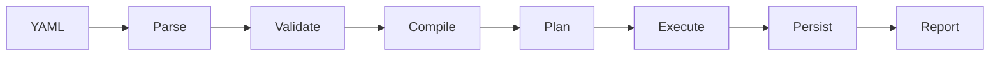

# Pipeline architecture

The pipeline is a strict seven-stage engine. Later stages never re-parse YAML and
earlier stages never execute processes.



## Modules

| Module | Responsibility |
| --- | --- |
| `src/pipeline/parser` | Read UTF-8 YAML, enforce 1 MiB limit, deserialize |
| `src/pipeline/schema` | Serde models with `deny_unknown_fields` |
| `src/pipeline/validator` | Semantic checks independent of the host |
| `src/pipeline/compiler` | Schema → `WorkflowIr`; dependency order and waves |
| `src/pipeline/matrix` | Deterministic Cartesian expansion + include/exclude |
| `src/pipeline/expression` | Lexer/parser/evaluator for templates and `if` |
| `src/pipeline/planner` | Host capability resolution, no side effects |
| `src/pipeline/runtime` | Wave scheduler, job/step execution, persistence |
| `src/pipeline/history` | Read runs, logs, cancel markers, stale recovery |
| `src/pipeline/artifacts` | Content-addressed artifact store |
| `src/pipeline/cache` | Content-addressed workspace cache |
| `src/pipeline/actions` | Built-in `uses:` actions |
| `src/pipeline/events` | Human and NDJSON progress events |
| `src/pipeline/graph` | Mermaid/DOT/JSON rendering |
| `src/cli/pipeline_cmd` | CLI translation and JSON envelopes |

## Data flow

1. **Parse** produces `ParsedWorkflow { path, source, definition }`. Unknown
   fields fail with YAML line/column.
2. **Validate** checks ids, cycles, references, action inputs, expression
   syntax, limits and target strings. It accumulates diagnostics instead of
   stopping at the first error.
3. **Compile** creates immutable `IrJob`/`IrStep` values. Matrix jobs are
   expanded; ids become `base[axis=value,...]`. Dependency order is
   topological; waves are groups with no unmet `needs`.
4. **Plan** resolves each job's runner against the host and reports
   `executable` plus a reason. Planning performs no writes.
5. **Execute** runs each wave concurrently. Each job gets a fresh workspace,
   its own log directory and a step state machine. Jobs communicate only via
   artifacts and declared outputs.
6. **Persist** writes run/job/step/artifact rows to SQLite as they occur, so a
   crash leaves an inspectable `running` state that `pipeline recover` fixes.
7. **Report** returns `RunReport`; the CLI prints the JSON envelope or a compact
   terminal summary.

## Design invariants

- The parser and compiler never execute processes or touch the workspace.
- The planner has no side effects.
- The runtime receives IR, not YAML.
- Expressions are interpreted; there is no shell, JavaScript or `eval`.
- Ordering comes from `IndexMap` and topological sort, never hash iteration.
- Matrix expansion is capped at 256 jobs and rejects duplicate combinations.
- Every failure is an `UbuilderError` with a stable `ErrorCode`; callers may add
  `remediation` and structured `details`.

## Storage layout

```text
<data-dir>/
  ubuilder.db             SQLite run history and leases
  pipeline/
    runs/<run-id>/
      jobs/<job-id>/      isolated workspace
      logs/<job-id>/      step logs
      cancel              cancellation marker
    artifacts/
      objects/<sha>/
        tree/             content-addressed payload
        manifest.json     object metadata
    cache/
```

`UBUILDER_DATA_DIR` overrides the data directory. `--workspace` overrides the
root directory that holds isolated job workspaces.

## Relationship to the legacy builder

Actions call the same adapters and planners used by `ubuilder build/package`.
No second build engine exists. The pipeline adds orchestration, isolation,
history and artifact transport around those primitives.
