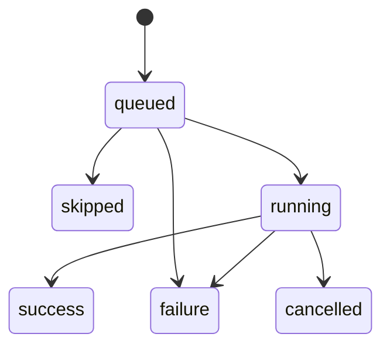

# Runtime semantics

`pipeline run` compiles the workflow, resolves the host, initializes the run
directory and executes dependency waves.

## Run lifecycle

1. Validate `--run-id` or generate `run-<nanos-hex>-<digest-prefix>`.
2. Create `<data-dir>/pipeline/runs/<run-id>/{jobs,logs}` and remove any stale
   cancellation marker for the same id.
3. Insert a `running` row in SQLite and persist every selected job as `queued`.
4. For each wave, spawn one Tokio task per job. A wave only starts when all
   previous waves finished.
5. Finalize the run as `success`, `failure` or `cancelled`; collect artifacts and
   return `RunReport`.

A crash between 3 and 5 leaves a `running` row. `pipeline recover --stale-secs`
marks such runs and running jobs as failed so history never lies about a live
process.

## Isolation

Each job gets:

```text
runs/<run-id>/jobs/<safe job id>/   workspace
runs/<run-id>/logs/<job id>/        streamed step logs
```

The workspace is reset before every attempt. `builtin/checkout@v1` copies the
project into it, excluding `.git`, `target`, `node_modules`, `.ubuilder`, `dist`
and `dist-smoke`. Jobs share no filesystem state. The only channels are:

- artifacts (`builtin/upload-artifact` → `builtin/download-artifact`)
- job outputs (`outputs:` → `${{ needs.<job>.outputs.<name> }}`)
- run inputs and workflow env

Injected environment:

| Variable | Value |
| --- | --- |
| `UBUILDER_RUN_ID` | Run id |
| `UBUILDER_JOB_ID` | Job instance id, matrix suffix included |
| `UBUILDER_WORKSPACE` | Absolute job workspace |
| `UBUILDER_RUNNER_OS` | Resolved OS |
| `UBUILDER_RUNNER_ARCH` | Resolved architecture |

The environment is filtered through the configured allowlist plus workflow, job
and step env.

## Scheduling

- Waves are computed from `needs`; a job waits for the whole previous wave.
- Jobs within a wave run concurrently.
- Matrix siblings share a semaphore keyed by `base_id`.
  - `max-parallel` sets the limit.
  - With `fail-fast: true` and no explicit limit, the limit is **1**, making
    failure order deterministic and allowing remaining siblings to be skipped.
  - With `max-parallel > 1`, already-running siblings are not cancelled; only
    siblings that have not started become `skipped`.
- `--job <id>` selects a base job or instance plus all transitive dependencies.
- A cancelled run stops scheduling further waves.

## Job and step states



Step states: `queued`, `running`, `success`, `failure`, `skipped`, `cancelled`.

- A skipped job materializes all its steps as `skipped`.
- A dependency that fails, is cancelled or is skipped causes dependents without
  an explicit `if` to be `skipped`.
- `if: always()` still runs after a failed dependency; `success()`, `failure()`
  and `cancelled()` reflect the current job state while steps execute.
- `continue-on-error` keeps the step's `status: failure` but sets
  `conclusion: success`; the job continues and does not fail because of it.
- Outputs are evaluated only when the job did not fail and the run was not
  cancelled.

## Timeouts and retries

- Step timeouts are enforced by the executor. The process tree is terminated
  (`taskkill /T /F` on Windows, process group `SIGTERM`/`SIGKILL` on Unix) and
  the step reports `failure` with a timeout error.
- Job timeouts wrap the entire job body, including all steps.
- Retry policies re-run the body from a reset workspace. Cancellation and the
  attempt limit end retries. Backoff supports fixed and exponential delays
  (`delay * 2^(attempt-1)`, capped).

## Cancellation

`pipeline cancel <run-id>` writes `runs/<run-id>/cancel`. Every active runner
polls that marker every 200 ms, cancels its token, terminates running process
trees and stops scheduling. The CLI reports `status: cancelled` and exit code
130. The marker remains on disk for audit; a later run with the same id removes
it first.

## Cache

`builtin/cache@v1` keys entries by:

```text
sha256("pipeline/v1/<host>/<workflow-digest>\n<user-key>")
```

The workflow digest changes whenever the YAML changes, so cache entries cannot
silently cross workflow definitions. `--no-cache` disables restore and save.
Saves run at the end of a job only when the step missed and the directory exists.

## Persistence

SQLite tables record runs, jobs, steps, artifacts and concurrency leases. Rows
are written as execution progresses, not only at the end. `status`, `history`,
`logs` and `recover` read this database. Artifact payloads live on disk in the
content-addressed store; the database stores metadata.

## Reports

`RunReport` contains run status, timings, run/workspace/log directories, every
`JobReport` (including skipped jobs), steps with exit codes and tail output,
outputs and artifact references. `--json` prints this report inside the standard
envelope. A failed run still prints the report and exits `1`.
