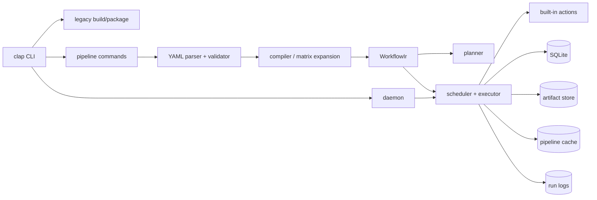

# Architecture review

## Shape

`ubuilder` is a single Rust crate with a library (`src/lib.rs`) and one binary.
The legacy build path (`build`, `package`, `release`) and the declarative
pipeline share detection, target capability, executor, cache and storage.
There is one scheduler: `pipeline::runtime`.

## Key components

| Component | Responsibility | Evidence |
| --- | --- | --- |
| `pipeline::parser` / `validator` / `compiler` | Strict YAML boundary, diagnostics, matrix expansion, deterministic waves. | Contract tests, unit tests. |
| `pipeline::runtime` | DAG waves, dependency readiness, fail-fast, retries, timeouts, cancellation, concurrency slots, secrets, persistence. | Runtime integration suite. |
| `pipeline::state` | One typed lifecycle for runs, jobs and steps; transition table; legacy persisted spellings. | Unit tests + DB transition checks. |
| `executor` | Process launch, streamed output, process-tree termination. | Runtime timeout/cancel tests. |
| `storage::Db` | Single SQLite connection behind a mutex; schema, transitions, locks, retention primitives. | Storage unit tests. |
| `pipeline::cache` | Content-addressed tree cache with per-key locks and corruption detection. | Cache unit + runtime tests. |
| `pipeline::artifacts` | Content-addressed objects, manifests, integrity verification, retention-safe publish. | Artifact tests. |
| `secrets` | Environment/file providers, masked values, fail-closed resolution, redaction. | Runtime + CLI tests. |
| `cli::daemon` | Git/workflow polling, loopback webhook, staff trigger file. | Once-mode integration test. |

## Scheduling and lifecycle

- Jobs execute in deterministic dependency waves. Matrix siblings share a
  per-base-id semaphore.
- Fail-fast stops *new* sibling scheduling. It does not cancel running
  siblings and never changes the concurrency limit.
- A job acquires a bounded concurrency slot before its body and releases it
  after the body. Slots have a 1 h lease for crash tolerance; normal completion
  deletes the slot.
- Run, job and step writes are validated against a transition table inside a
  SQLite transaction.
- Cancellation is cooperative: an in-process token plus a `cancel` marker file,
  polled every 200 ms. The daemon also uses the marker for `cancel-in-progress`.

## Persistence

SQLite is the source of truth for run history, jobs, steps, artifact references,
cache entries, concurrency slots, pins and schema version. `schema_migrations`
records version 1. The current code creates the schema idempotently but does not
reject a *newer* schema version; downgrade safety is a known limitation.

Artifact objects are content-addressed. Deleting a run removes only its rows and
run directory; objects survive until `maintenance gc`, so shared objects remain
valid. Pinned objects are never collected.

## Secrets

Secrets are resolved once per run from names referenced in the IR. Resolution is
fail-closed before any job starts. Raw values are kept in memory for `needs`
context; every persisted/printed surface is redacted. `SecretValue` has a masked
`Debug`. The file provider uses a lock, atomic replace and restrictive
permissions where the platform supports them.

## Architecture decisions

| Decision | Reason | Consequence |
| --- | --- | --- |
| One scheduler in the runtime | Avoid divergence between legacy and pipeline execution. | Legacy commands intentionally do not reuse DAG semantics. |
| Typed state with legacy strings | Preserve existing databases and JSON consumers. | `RunState` accepts `queued`/`success`/`failure` spellings. |
| Step-scoped cache keys | Unrelated workflow edits must not evict good caches. | Callers must include toolchain inputs in the key. |
| Facts cache, 30 s TTL | Tool probing dominates planning. | Toolchain installs may be invisible for up to 30 s; `UBUILDER_NO_FACTS_CACHE=1` bypasses. |
| Retention keeps newest runs | Bounded storage without deleting active work. | Pinning is the explicit escape hatch. |
| Daemon delegates runs to the CLI | Keeps one runtime and preserves JSON/log behavior. | Daemon is not a scheduler for concurrent runs; runs are serialized. |

## Review findings

- The storage layer is a single mutex; acceptable for a local CLI, but a
  long-running daemon with many concurrent commands can contend.
- `pipeline plan` still performs project detection on every call. Warm planning
  of 48 jobs is ~71 ms; cold planning is dominated by toolchain probes.
- A crash leaves concurrency slots until the 1 h lease expires. Normal runs
  release all slots they hold.
- Workspace isolation is per-job, not an OS sandbox. Untrusted actions can read
  the host filesystem; see the threat model.
